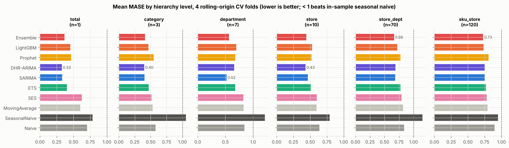
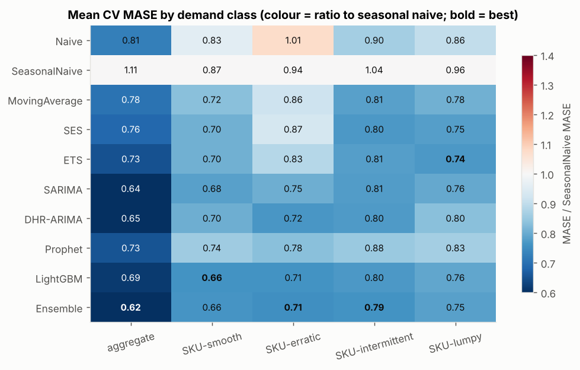
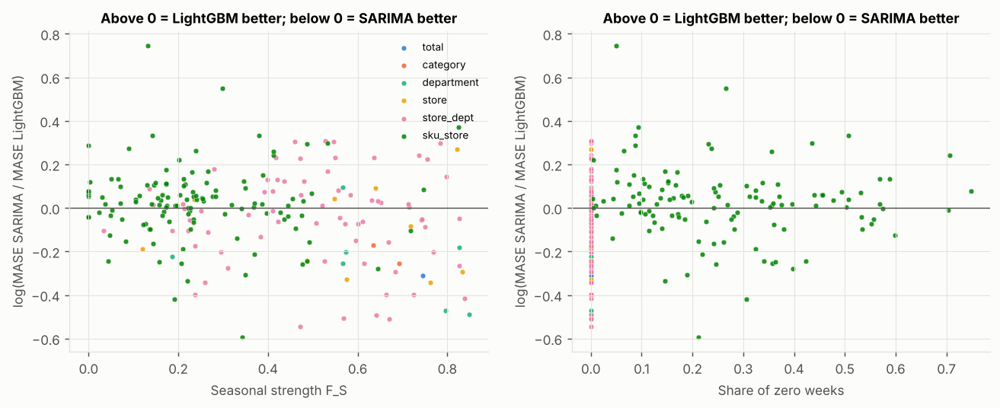
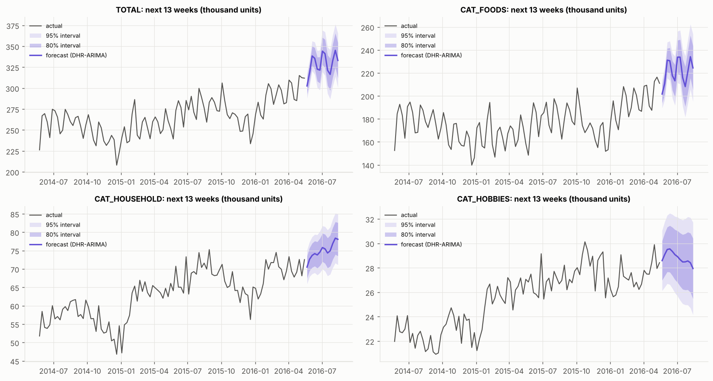
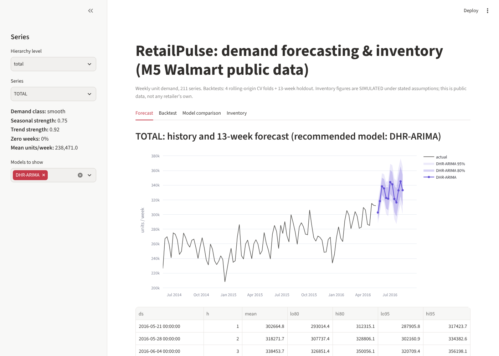

# RetailPulse: Retail Demand Forecasting & Inventory Optimization

Weekly demand forecasting for **211 retail series** (total → category → department → store → store × department →
120 SKU × store) on the public **Walmart M5** dataset. Ten models (naive baselines, ETS, SARIMA, Fourier‑ARIMAX,
Prophet, a global LightGBM and an ensemble) are benchmarked under one **leakage‑free rolling‑origin protocol** (4 CV
folds + an untouched 13‑week holdout). The study explains **which model works on which kind of series and why**, and
turns forecasts into **safety stock / reorder points**, back‑tested in a simulated replenishment policy.
Full study: **[REPORT.md](REPORT.md)** · decision log: **[DECISIONS.md](DECISIONS.md)** · notebooks: [`notebooks/`](notebooks).

> Public US data (Walmart, 2011‑2016; food/household/hobbies), not Trent/Westside/Zudio data. Inventory numbers are
> **simulated** under stated assumptions. Forecasts are probabilistic estimates.

## Key results (all produced by the code in this repo)

| Model | CV mean MASE (211 series) | Holdout mean MASE | CV mean MASE, aggregates (91) | CV mean MASE, SKUs (120) | CV pooled WAPE, aggregates |
|---|---|---|---|---|---|
| **Ensemble (SARIMA + LightGBM)** | **0.681** | **0.668** | **0.621** | **0.727** | 5.4% |
| SARIMA (AutoARIMA, s = 52) | 0.701 | 0.699 | 0.636 | 0.751 | 5.3% |
| DHR‑ARIMA (Fourier + holidays + SNAP) | 0.708 | 0.728 | 0.646 | 0.754 | **5.1%** |
| LightGBM (global, direct multi‑horizon) | 0.712 | 0.678 | 0.686 | 0.733 | 6.3% |
| ETS | 0.750 | 0.739 | 0.725 | 0.769 | 6.3% |
| Prophet | 0.774 | 0.789 | 0.727 | 0.809 | 6.4% |
| Naive | 0.860 | 0.826 | 0.807 | 0.899 | 7.9% |
| Seasonal naive | 1.020 | 1.051 | 1.113 | 0.950 | 10.2% |

*MASE < 1 = better than the in‑sample seasonal‑naive error. Source: `reports/tables/leaderboard_*.csv`.*

- **SARIMA is the best single model on aggregate series** (significantly better than LightGBM: ΔMASE −0.050, 95% CI
  [−0.084, −0.017]) and is clearly best at department level. **A global LightGBM is the best single model on SKU
  series.** The **ensemble** is best overall (better than SARIMA on 68% of series).
- SARIMA's win rate vs LightGBM rises from **38% → 66%** as seasonal strength goes from ≤ 0.2 to > 0.6. On
  zero‑heavy SKUs its advantage disappears.
- **Per‑series "best model" is mostly noise:** CV and holdout winners agree on only 12.8% of series.
- **Simulated inventory** (lead time 2 weeks, 95% service, 120 SKUs): the ensemble‑driven policy cut the cost proxy by
  **42.8%** and raised fill rate from **89.5% to 93.6%** vs a seasonal‑naive policy. It still missed the 95% target
  (see REPORT §12).

<p align="center">
<br>
 <br>
 
</p>

## Quickstart
```bash
make setup     # python3 -m venv .venv + pinned requirements.txt
make data      # download M5 without Kaggle login (SHA-256 checked) + validate + build weekly series
make all       # eda -> train (~45 min on 4 cores) -> eval -> why -> forecast -> inventory -> export -> notebooks -> test
make app       # Streamlit dashboard (forecasts, backtests, leaderboards, inventory, at-risk list)
```
Power BI: tidy CSVs in `outputs/powerbi/` + step‑by‑step guide in [docs/POWERBI_GUIDE.md](docs/POWERBI_GUIDE.md).

## Project structure
```
config/config.yaml         horizon, folds, seeds, lead times, service levels, costs
src/data/                  download (HTTP or sparse git, checksum), prepare/validate, load + time splits
src/features/              characteristics (STL strength, ADI/CV²), exogenous calendar, leakage-safe LightGBM features
src/models/                statistical models, rolling-origin runner, global LightGBM, price ablation
src/evaluation/            metrics, Diebold-Mariano + bootstrap, leaderboards/coverage
src/analysis/              EDA, SARIMA deep dive, why-analysis
src/inventory/             safety stock / ROP / order-up-to, lost-sales simulator + recommendations
src/forecast_final.py      refit on all data, 13-week forecast with 80/95% intervals
app/streamlit_app.py       dashboard
notebooks/01..06           executed notebooks with the WHY behind every step
reports/                   figures, tables, data_profile.json, series_characteristics.csv
outputs/                   forecasts.csv, inventory_recommendations.csv, powerbi/
tests/                     26 pytest tests incl. a no-leakage proof
```

## Dataset & licence
M5 Forecasting (Walmart / University of Nicosia), obtained from the public mirror used by Nixtla's `datasetsforecast`.
Raw data is **not** redistributed here (`make data` downloads it). Citation: Makridakis, Spiliotis & Assimakopoulos
(2022), *M5 accuracy competition: Results, findings, and conclusions*, International Journal of Forecasting 38(4).
Code: MIT licence.

## Limitations
- Public, non‑apparel US data: the methods transfer to fashion retail, the numbers do not.
- Sales ≠ demand: stock‑outs are unobserved (censoring); there are no promotion flags.
- Inventory results are a 13‑week **simulation** with assumed lead times and costs, not realised savings.
