# RetailPulse: Retail Demand Forecasting & Inventory Optimization

*A reproducible study on public Walmart (M5) data. Author: Piyush Das. Every number in this report was produced
by the code in this repository. Tables are inserted automatically from `reports/tables/*.csv` by
`scripts/render_report.py`; the narrative numbers were checked against those tables.*

> **Read this first.** This is public US data (Walmart, 2011-2016, food/household/hobbies), **not** Trent,
> Westside or Zudio data. The inventory results come from a **simulation** under stated assumptions; they are not
> realised savings. Forecasts are probabilistic estimates, not guarantees.

---

## Contents
1. Executive summary
2. Business context
3. The dataset
4. Problem definition
5. Exploratory analysis
6. Stationarity and decomposition: implications for model choice
7. Models
8. SARIMA deep dive
9. Results
10. Why each model works where it does (and not elsewhere)
11. Final forecast
12. Inventory optimization
13. Limitations and threats to validity
14. Conclusions and next steps with real company data
15. Appendix: environment, reproduction, test results, glossary, full tables, interview Q&A

---

## 1. Executive summary

**Problem.** Forecast weekly unit demand 13 weeks (one quarter) ahead across a retail hierarchy, and turn the
forecasts into replenishment decisions (safety stock, reorder point, order-up-to level).

**Data.** M5 (Walmart): 30,490 item x store daily series, 2011-01-29 to 2016-05-22. These were aggregated into 277
complete Walmart weeks, and **211 series** were modelled: the total, 3 categories, 7 departments, 10 stores, 70
store x department series, and 120 item x store (SKU) series stratified 30 per demand class (smooth / erratic /
intermittent / lumpy).

**Protocol.** Ten models evaluated identically: 4 rolling-origin cross-validation folds (13-week windows) plus a
final untouched 13-week holdout. Metrics: WAPE (primary for volume-weighted error), MASE (cross-series ranking),
bias, RMSE, MAE, sMAPE, interval coverage. Differences are tested with Diebold-Mariano tests and a paired bootstrap.

**Headline findings (all from executed code):**
- **Best overall:** an equal-weight **ensemble of SARIMA and a global LightGBM**. CV mean MASE **0.681** (holdout
  0.668), against **1.020** (holdout 1.051) for seasonal naive and 0.860 for naive. It beats SARIMA on 68% of
  series (bootstrap ΔMASE −0.020, 95% CI [−0.030, −0.011]).
- **SARIMA is the best single model on the 91 aggregate series**: CV mean MASE 0.636, pooled WAPE 5.3% vs 10.2%
  for seasonal naive. It is significantly better than LightGBM there (ΔMASE −0.050, CI [−0.084, −0.017]) and
  than ETS (−0.089). It is clearly best at department level (0.519).
- **On the 120 SKU series a global LightGBM is the best single model** (0.733 vs SARIMA 0.751). The advantage is
  small (CI [−0.004, +0.040] includes 0) and survives removing the price features (0.741).
- **The owner's prior was confirmed with nuance.** SARIMA is strong on seasonal, trending, zero-free aggregates
  (it beats LightGBM on 66% of series with seasonal strength > 0.6, but on only 38% with seasonal strength ≤ 0.2).
  A Fourier/holiday/SNAP regression with ARIMA errors (DHR-ARIMA) is **statistically tied** with it (CI
  [−0.023, +0.010]). On noisy, zero-heavy SKUs SARIMA's advantage disappears.
- **Seasonal naive is the worst model here** (aggregate median bias −11.6%): five years of strong growth make
  "same week last year" systematically too low.
- **Per-series model choice is mostly noise**: the CV-best model is also holdout-best on only 12.8% of series;
  most per-series DM tests are not significant. The robust differences are at the group level.
- **Interval calibration varies a lot:** SARIMA, DHR-ARIMA and LightGBM are close to nominal (about 83-86% inside
  80% intervals), while ETS (50%) and Prophet (58%) are badly too narrow on aggregates.
- **Inventory (SIMULATED, lead time 2 weeks, 95% service, 13-week holdout):** across 120 SKUs, the
  ensemble-driven order-up-to policy cut the holding+shortage cost proxy by **42.8%** and raised fill rate from
  **89.5% to 93.6%** versus a seasonal-naive-driven policy. The ranking holds for all 12 lead-time x
  service-level combinations. It still fell short of the 95% target (weekly stock-out rate 7.2%); the reasons are
  discussed in section 12.

**Recommendation.** Forecast store x category-type aggregates with SARIMA or DHR-ARIMA (interpretable,
calibrated). Forecast the SKU long tail with a global gradient-boosting model. Deploy the SARIMA + LightGBM
average as the default, and size safety stock from cross-validated forecast errors, not from raw demand
variability.

---

## 2. Business context

In fashion and general-merchandise retail, demand forecasting drives three decisions with very different horizons:
**buying** (months ahead: how much to order from vendors), **allocation** (weeks ahead: which store gets how much)
and **replenishment** (days to weeks ahead: when to reorder a continuing line). Errors are asymmetric. An
under-forecast means a lost sale and a disappointed customer (in value fashion, the customer simply buys elsewhere).
An over-forecast means capital tied up in stock, warehouse space and, for seasonal fashion, end-of-season markdowns.
Value-fashion formats like Zudio and premium-department formats like Westside (Trent Limited) face both: a
fast-moving core of basics that replenishes continuously, and a long tail of size/colour options with intermittent
demand. That is exactly the aggregate vs SKU split studied here, although **no Trent data is used and no claim about
Trent's operations is made.**

What this project demonstrates for such a business: (1) how to choose a forecasting method per *type* of series
with evidence; (2) how to evaluate forecasts honestly (time-based backtests, significance tests, interval
calibration); (3) how forecasts become inventory parameters and what that is worth under clearly stated
assumptions.

---

## 3. The dataset

### 3.1 Choice, source, licence
| Item | Detail |
|---|---|
| Name | M5 Forecasting - Accuracy (Walmart), 2020 competition by the University of Nicosia (MOFC) and Walmart |
| Obtained from | the public mirror used by Nixtla's `datasetsforecast` package (`github.com/Nixtla/m5-forecasts`, `datasets/m5.zip`), so no Kaggle login is needed |
| Integrity | SHA-256 `cc704ba15d6802f8262e6ec7d4c6041e4ad6366a94365e8c84f721e450eed774` (checked by `src/data/download.py`) |
| Licence / use | released for the M5 competition for research and educational use; this repository does **not** redistribute the raw data (download script only) and commits only small derived aggregates |
| Citation | Makridakis, S., Spiliotis, E., & Assimakopoulos, V. (2022). *M5 accuracy competition: Results, findings, and conclusions.* International Journal of Forecasting, 38(4), 1346-1364. |

**Candidates considered (in the required order):** (a) M5 via `datasetsforecast`: accepted (the raw URL was
blocked by the build sandbox's proxy, and the same file was obtained by a sparse git clone of the same public
repository); (b) UCI Online Retail II: reachable, but not needed and weaker (a single UK web shop, about 2 years,
transaction-level cleaning, no price/calendar tables); (c) Rossmann/Favorita: needed Kaggle credentials, which were
not available; (d) not needed.

**Selection criteria:** ≥ 2 years (5.3 years: pass); regular axis (0 calendar gaps, 0 missing cells: pass);
20+ series (30,490: pass); real demand (recorded unit sales: pass); usable licence (research use: acceptable).

### 3.2 Schema
- `sales_train_evaluation.csv` (30,490 x 1,947): `item_id`, `dept_id`, `cat_id`, `store_id`, `state_id`, then
  `d_1 … d_1941` = units sold per day. The mirror drops Kaggle's redundant `id` column, which we rebuild.
- `calendar.csv` (1,969 x 13): date, Walmart week `wm_yr_wk`, weekday, month, year, up to two events per day with
  their type (Sporting / Cultural / National / Religious), and SNAP flags per state (days on which food-assistance
  benefits are paid).
- `sell_prices.csv` (6,841,121 x 4): weekly shelf price per store x item x week. A row exists only when the item
  is on sale.

### 3.3 Validation (`reports/data_profile.json`)
No missing sales cells, no duplicate ids or price keys, no negative sales or prices, no calendar gaps. 68.0% of
daily item x store cells are zero. The five days with total sales < 10% of the median are all 25 December (stores
closed).

### 3.4 Cleaning and construction decisions
| Decision | Why | Alternative rejected |
|---|---|---|
| Weekly buckets = Walmart weeks (Sat-Fri); 277 complete weeks; final 2 days dropped | a partial week would look like a demand collapse | calendar ISO weeks (would split Walmart's own week) |
| "Not listed" (no price row) = **no data**, not zero demand | verified: 0 units were sold in unlisted weeks; launch zeros would bias models to 0 | treating all zeros as demand |
| SKU series start at first listed week; eligibility ≥ 200 listed weeks, no gaps | guarantees ≥ 2 seasonal cycles before the first origin | include new launches (cold start is a separate problem) |
| Keep Christmas closures and level shifts | real calendar/business effects, not errors | capping/deleting (would erase real behaviour) |
| Keep suspected stock-out zero runs | true demand is unknown; imputing would invent data | imputation (needs inventory records we don't have) |

### 3.5 Limitations of the data for real retail demand
No apparel; sales ≠ demand (stock-outs unobserved: 59 of 120 sampled SKUs show ≥ 4-week zero runs despite
normally selling ≥ 5 units); no promotion flags (prices change in only 1.4% of SKU-weeks); no lead times, costs or
inventory positions; a US-specific calendar.

---

## 4. Problem definition
*(Written and committed before any model code; see `DECISIONS.md` D-08 to D-16.)*

| Decision | Choice | Why | Alternatives |
|---|---|---|---|
| Target | units | inventory is planned in units; revenue mixes in price | revenue |
| Granularity | weekly | removes the day-of-week pattern (Saturday +21%, Wednesday −13% vs the average day); zero share of listed SKU-weeks drops to 23.9%; matches weekly ordering | daily (noisy, 68% zeros), monthly (≈ 64 points, blurs holiday weeks) |
| Horizon | 13 weeks | a merchandise-planning quarter; its first 1-5 weeks feed replenishment | 4 weeks (M5), 26 weeks |
| Series | 211 across 6 levels, SKUs stratified by demand class | enables the "which model for which series" analysis | random SKU sample (51% smooth, few erratic) |
| Protocol | expanding-window rolling origin: 4 CV folds + 13-week holdout; 2 extra pre-CV origins for LightGBM tuning only | uses ~1 year of out-of-sample tests across seasons; tuning never touches CV or holdout | random split (leaks the future: a lag-52 feature would contain the test value), single split (fragile) |
| Primary metric | WAPE (volume-weighted), MASE for cross-series ranking | scale-free, defined with zeros, error weighted by volume | MAPE (undefined/infinite at 0 actuals) |
| Baselines | naive, seasonal naive, 4-week moving average | a model that cannot beat "same week last year" is not worth its maintenance cost | none |

**Metric definitions.** WAPE = Σ|y − ŷ| / Σy. MASE = MAE / (in-sample MAE of seasonal naive with lag 52), so MASE < 1
means better than seasonal naive's in-sample error. Bias = Σ(ŷ − y) / Σy (+ means over-forecast, i.e. overstock;
− means under-forecast, i.e. stock-outs). sMAPE = mean(2|y − ŷ| / (|y| + |ŷ|)): reported only for completeness,
because it is asymmetric and unstable near zero. Per-series metrics are summarised by the **median across series**
(robust) and **pooled** (volume-weighted) within a group; MASE is averaged across series.

---

## 5. Exploratory analysis

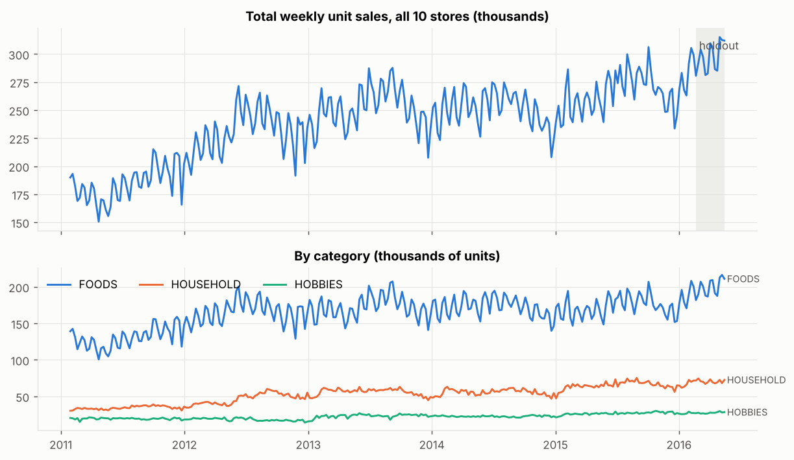

**Trend and level shifts.** Average weekly total units: 184k (2011), 231k (2012), 252k (2013), 251k (2014), 265k
(2015) and 283k in the pre-holdout weeks of 2016. *Meaning:* there is a strong trend with a changing slope, so a
model must follow the level; this is why seasonal naive fails (section 9).

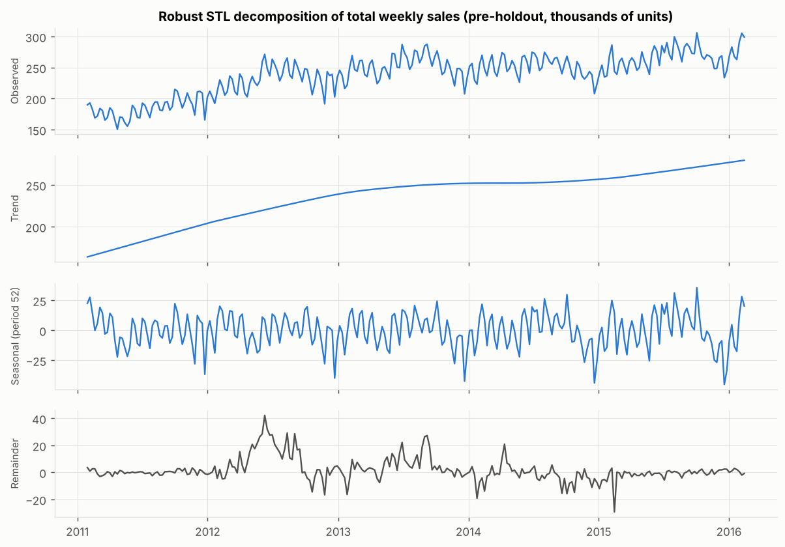

**STL decomposition** (robust LOESS, period 52) was preferred to classical decomposition because it lets the
seasonal shape evolve and down-weights outliers. The STL remainder flags 38 pre-holdout weeks with |robust z| > 3.5,
but they come in long runs (May-September 2012 is all positive), which is a **level/seasonal-amplitude shift**, not
isolated bad points. *Decision:* leave them (`reports/tables/outliers_total.csv`).

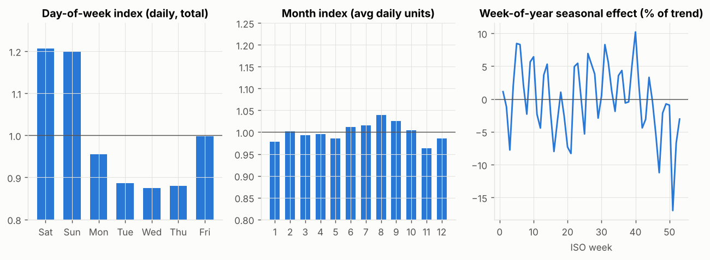

**Calendar effects.** Day-of-week index: Saturday 1.21, Sunday 1.20, Wednesday 0.88 (absorbed by weekly
bucketing). Month index ranges from 0.96 (November) to 1.04 (August). Event weeks vs the average of their
neighbouring weeks:

| event | n_weeks | mean_lift_vs_adjacent_weeks_pct |
|---|---|---|
| christmas | 5 | -13.15 |
| thanksgiving | 5 | -2.03 |
| easter | 6 | -2.00 |
| superbowl | 6 | 3.68 |
| other_events | 110 | 0.66 |

**SNAP (food-stamp days):** FOODS daily sales on SNAP vs non-SNAP days.

| state | foods_daily_nonSNAP | foods_daily_SNAP | lift_pct |
|---|---|---|---|
| CA | 9773.5 | 10733.4 | 9.8 |
| TX | 6478.5 | 7462.3 | 15.2 |
| WI | 6220.0 | 8052.0 | 29.5 |

*Meaning:* SNAP days are in the first half of every month, so weekly data contains a **~4.3-week cycle** that a
52-week seasonal model cannot represent. It shows in the ACF of differenced sales (lag 2 = −0.59, lag 4 = +0.65).

**Prices / promotions.** Prices change in only 1.4% of sampled SKU-weeks (median change 10.6%). The correlation
between weekly log-price change and log-units change is −0.03 (OLS slope −0.14). There are no promotion flags, so
promotion effects cannot be modelled (a limitation).

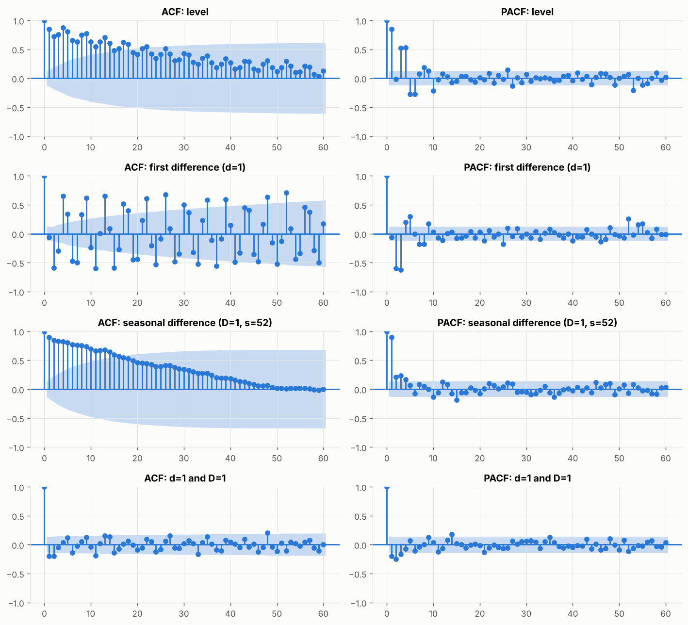

**ACF/PACF.** Level: slow decay (lag 1 = 0.85, lag 13 = 0.71), so there is a unit root/trend. After d = 1: lag 52
= +0.71 (annual cycle) plus the lag 2/4 monthly pattern. After D = 1 only: lag 1 = 0.90 (trend remains). After d = 1
and D = 1: small negative spikes at lag 1 (−0.20) and lag 52 (−0.10), suggesting MA(1) x seasonal MA(1) terms
(an "airline"-type structure) and no strong over-differencing.

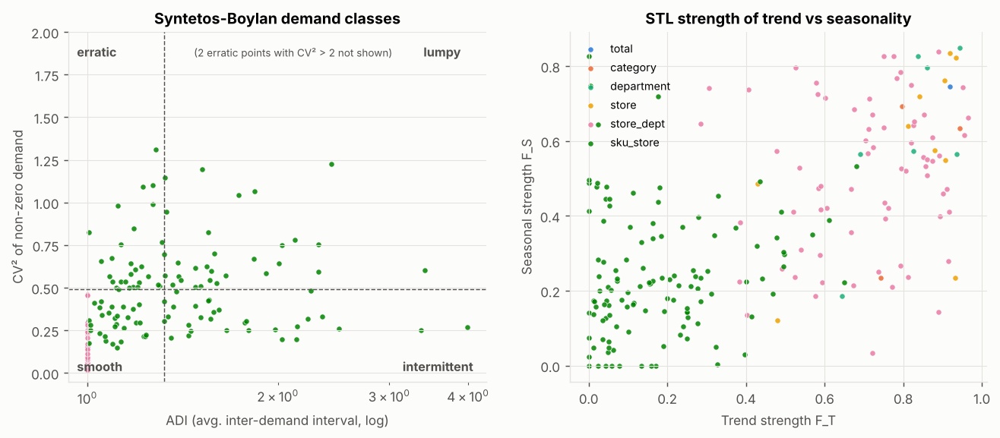

**Series characterisation** (`reports/series_characteristics.csv`, pre-holdout data only). All 91 aggregates are
*smooth* with strong trend (median F_T 0.74-0.92 by level) and moderate-to-strong seasonality (median F_S
0.53-0.75). SKUs have median F_T 0.14, F_S 0.21, 24% zero weeks and CV ≈ 1.0. **This predicts, before any
modelling, that model choice should differ between aggregates and SKUs.**

**Zeros and censoring.** 59 of 120 SKUs have a run of ≥ 4 zero weeks despite selling ≥ 5 units in a typical
non-zero week: suspected stock-outs. Observed sales therefore understate demand for those items; we keep the data
and state the limitation.

---

## 6. Stationarity and decomposition: implications for model choice

ADF (H0: unit root) and KPSS (H0: stationary) test opposite hypotheses. Agreement is decisive; disagreement
signals trend-stationarity, breaks or low power. Results on the 21 total/category/department/store series
(pre-holdout):

| transform | conflict: ADF rejects unit root, KPSS rejects stationarity (trend/difference-stationary?) | conflict: neither rejects (low power) | non-stationary (both agree) | stationary (both agree) |
|---|---|---|---|---|
| D=1 | 2 | 6 | 12 | 1 |
| d=1 | 0 | 0 | 0 | 21 |
| d=1,D=1 | 0 | 0 | 0 | 21 |
| level | 2 | 0 | 19 | 0 |

*Meaning:* **d = 1** is needed and sufficient for the non-seasonal part (21/21 stationary after one difference).
Seasonal differencing alone does not achieve stationarity (1/21), and these tests cannot decide D. D is therefore
chosen with the seasonal-strength rule (D = 1 if F_S > 0.64) used by `auto.arima`/statsforecast. Variance does
**not** grow with level on the total (yearly standard deviation 16k-19k while the mean rose 54%), so no log/Box-Cox
transform is used by default; this was confirmed out of sample in section 8.

---

## 7. Models
All models see exactly the same training window at each origin; forecasts are clipped at 0 (identically for all).

| Model | Theory in one line | Key assumptions | Setup / tuning | Why included |
|---|---|---|---|---|
| Naive | ŷ = last value | random walk | none | floor benchmark |
| SeasonalNaive | ŷ = same week last year (lag 52) | stable seasonality, no growth | none | the "planner's rule", must be beaten |
| MovingAverage | mean of last 4 weeks | locally flat level | window 4 (≈ 1 month) | smoothing without seasonality |
| SES | exponentially weighted level | level only | α by likelihood (statsforecast) | smoothing baseline |
| ETS | state-space level/trend/season with additive or multiplicative errors | stable components, Gaussian errors | candidates A/M error, N/Ad trend, N/A/M season (M only if y > 0), chosen by AICc counting 51 free seasonal states; statsmodels `ETSModel` because statsforecast's AutoETS drops seasonality for s > 24 | classical seasonal workhorse |
| SARIMA | ARIMA on (seasonally) differenced data with lag-52 AR/MA terms | linear, Gaussian, constant parameters | statsforecast AutoARIMA (Hyndman-Khandakar stepwise AICc search; d by KPSS, D by seasonal strength; CSS approximation in the search, as R's auto.arima does by default for long/high-period series) | the highlighted model |
| DHR-ARIMA | Fourier terms (period 52.18) + Christmas/Thanksgiving/Easter/Super Bowl week dummies + SNAP days + ARIMA errors | smooth seasonality, linear driver effects | K ∈ {2,4,6,8,10} chosen per series by AICc on pre-CV data; ARIMA orders re-selected at each origin | handles s = 52.18 and known drivers ("SARIMAX" family) |
| Prophet | piecewise-linear trend + yearly Fourier + holiday-week effects + SNAP regressor | additive components | defaults; holidays as weekly events | popular, holiday-aware |
| LightGBM | one global gradient-boosted tree model for all 211 series; direct multi-horizon | relationships shared across series and time | target and lags scaled by the trailing-52-week mean; features in section 7.1; tuned on 2 pre-CV origins only | cross-series learning, exogenous drivers, nonlinearity |
| Ensemble | mean of the best statistical model (by CV: SARIMA) and LightGBM | errors not perfectly correlated | components fixed using CV results only | forecast combination is usually robust |

### 7.1 LightGBM design (leakage control)
- **Direct, not recursive.** One row per (series, origin T, horizon h ≤ 13) with h as a feature. Recursive
  forecasting feeds predictions back as lags, so errors compound over 13 steps and future exogenous inputs must be
  simulated; the direct strategy avoids both, at the cost of more training rows (327k-541k).
- **Features from y use only weeks ≤ T:** last 4 values, rolling means (4/8/13/26/52), rolling std (4/13/52), zero
  shares, 26-week slope, year-over-year ratio, seasonal lags y[T+h−52] and y[T+h−104] (≤ T because h ≤ 13),
  series age. **Known-in-advance target-week features:** week of year, month, holiday/event counts, SNAP days, and
  the planned shelf price relative to the trailing average (an assumption, ablated below). Categorical IDs: level,
  category, department, store.
- **Leakage test** (`tests/test_no_leakage.py`): build the features, overwrite every future value with garbage,
  rebuild, and assert the features are identical. Also assert that no training target lies after the origin. Passes.
- **Training labels** are winsorised at their 99.9th percentile (a few SKUs with near-zero trailing scale gave
  scaled targets > 20).
- **Tuning** (12-point grid, mean MASE on the two tuning origins only):

| num_leaves | learning_rate | min_data_in_leaf | feature_fraction | n_estimators | mean_MASE_tuning | MASE_tune1 | MASE_tune2 |
|---|---|---|---|---|---|---|---|
| 31 | 0.0300 | 50 | 0.8000 | 600 | 0.7081 | 0.7191 | 0.6970 |
| 63 | 0.0300 | 50 | 0.8000 | 300 | 0.7107 | 0.7228 | 0.6987 |
| 63 | 0.0300 | 50 | 0.8000 | 600 | 0.7113 | 0.7140 | 0.7086 |
| 15 | 0.0300 | 200 | 0.8000 | 600 | 0.7124 | 0.7244 | 0.7003 |
| 31 | 0.0300 | 200 | 0.8000 | 300 | 0.7158 | 0.7229 | 0.7087 |
| 31 | 0.0300 | 50 | 0.8000 | 300 | 0.7161 | 0.7300 | 0.7023 |
| 31 | 0.0300 | 200 | 0.8000 | 600 | 0.7171 | 0.7156 | 0.7186 |
| 15 | 0.0300 | 50 | 0.8000 | 600 | 0.7200 | 0.7345 | 0.7056 |
| 63 | 0.0300 | 200 | 0.8000 | 300 | 0.7217 | 0.7171 | 0.7262 |
| 63 | 0.0300 | 200 | 0.8000 | 600 | 0.7255 | 0.7137 | 0.7374 |
| 15 | 0.0300 | 200 | 0.8000 | 300 | 0.7272 | 0.7409 | 0.7135 |
| 15 | 0.0300 | 50 | 0.8000 | 300 | 0.7361 | 0.7461 | 0.7261 |

The spread across all 12 points is small (0.708-0.736), so hyper-parameters matter little.
- **Prediction intervals:** empirical quantiles of scaled errors from *earlier* origins only (split-conformal
  style), by group and horizon bucket.

---

## 8. SARIMA deep dive (TOTAL series)

**Notation.** SARIMA(p,d,q)(P,D,Q)[s]: p AR lags, d ordinary differences, q MA lags; P, D, Q the same at the
seasonal lag s = 52. Orders were **identified using only weeks 0-211** (CV fold 1 training data) and evaluated on
all later windows with parameters re-estimated, so the order choice never saw its test data.

1. **Differencing:** `ndiffs` (KPSS) = 1, `nsdiffs` (seasonal strength 0.684 > 0.64) = 1, so d = 1, D = 1.
   Over-differencing would show as a strongly negative lag-1 residual autocorrelation; none is seen.
2. **Order search:** AICc over p ≤ 3, q ≤ 2, P ≤ 1, Q ≤ 1 (48 models, 50 s). AICc winner: **(3,1,2)(0,1,1)[52]**.
   Information criteria measure in-sample fit, so the top 6 were re-checked out of sample:

| order | aicc | cv_mean_MASE | cv_mean_WAPE | holdout_WAPE | aicc_rank | cv_rank |
|---|---|---|---|---|---|---|
| (3,1,2)(0,1,1)[52] | 3337.4372 | 0.3092 | 0.0266 | 0.0212 | 1 | 3 |
| (3,1,0)(0,1,0)[52] | 3340.1210 | 0.3130 | 0.0270 | 0.0211 | 2 | 4 |
| (3,1,0)(0,1,1)[52] | 3340.3369 | 0.3005 | 0.0258 | 0.0231 | 3 | 1 |
| (0,1,2)(0,1,0)[52] | 3340.5323 | 0.3193 | 0.0275 | 0.0243 | 4 | 5 |
| (0,1,2)(0,1,1)[52] | 3341.1746 | 0.3010 | 0.0258 | 0.0255 | 5 | 2 |
| (2,1,1)(0,1,0)[52] | 3341.2267 | 0.3222 | 0.0277 | 0.0246 | 6 | 6 |

   The top six are within ~4 AICc units, and CV ranks them differently (MASE 0.300-0.322). Many orders are
   equally good and **the result does not hinge on the exact order**. That justifies the automatic stepwise search
   for the 211-series benchmark: on the same window it chose (3,1,1)(1,1,1) with the CSS approximation (2.1 s) and
   (3,1,0)(0,1,0) with exact ML (17.5 s).
3. **Transformation:** log vs none, same orders, CV MASE:

| origin | log | none |
|---|---|---|
| cv1 | 0.2154 | 0.2299 |
| cv2 | 0.2775 | 0.3036 |
| cv3 | 0.4120 | 0.4022 |
| cv4 | 0.3182 | 0.3011 |
| holdout | 0.2844 | 0.2745 |

   The difference (0.306 vs 0.309 mean CV MASE) is negligible and not consistent across folds, so **no transform**
   is used (consistent with the constant variance in section 6).
4. **Residual diagnostics** (model fitted on weeks 0-263):

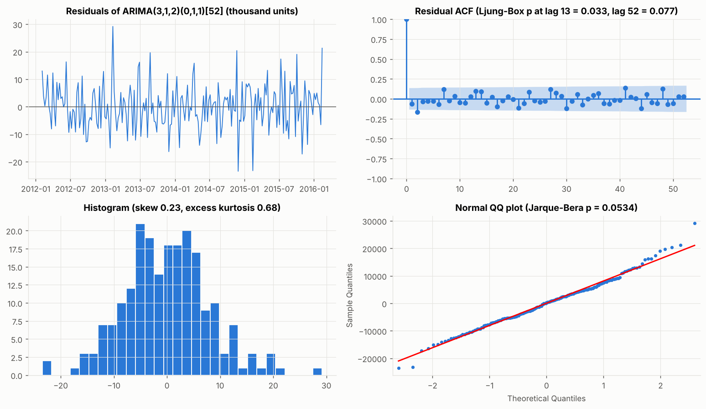

| lag | lb_stat | lb_pvalue |
|---|---|---|
| 4 | 7.1591 |  |
| 8 | 11.7406 | 0.0028 |
| 13 | 15.2805 | 0.0326 |
| 26 | 26.7281 | 0.1431 |
| 52 | 60.2533 | 0.0773 |

   *White-noise residuals* would mean the model has extracted all linear, predictable structure. Here Ljung-Box
   **rejects** at lags 8 (p = 0.003) and 13 (p = 0.033) but not at 26 (0.14) or 52 (0.08). The visible culprit is
   a lag-2 residual autocorrelation of −0.16, a plausible remnant of the monthly SNAP/payday cycle (half a ~4.3-week
   cycle apart gives a negative correlation). **The model captures the annual structure but not all short-cycle
   structure.** Normality: skew 0.23, excess kurtosis 0.68, Jarque-Bera p = 0.053, Shapiro p = 0.26, so roughly
   Gaussian with slightly heavy tails.
5. **Accuracy and interval calibration:**

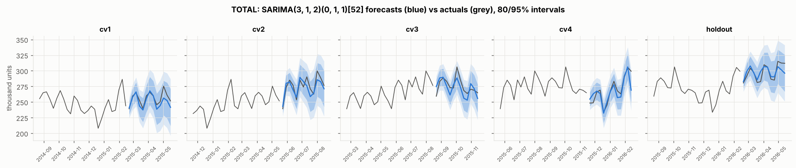

   WAPE 2.1-3.3% per 13-week window; bias −1% to −2% in CV (slight under-forecast during growth) and +0.1% on the
   holdout. Of 65 forecast weeks, **95.4% fell inside the nominal 80% interval and 100% inside the 95% interval**,
   so the TOTAL intervals are **too wide (conservative)**: σ² absorbs the 2012 shift and the unmodelled monthly
   cycle. Across all 211 series, AutoARIMA's intervals are close to nominal (section 9.4).
6. **The seasonal-period problem.** (i) A year is 52.18 weeks, so a lag-52 term drifts ~1 day per year and
   holidays move relative to "same week last year"; (ii) the SARIMA state vector grows with s, and statsmodels'
   SARIMAX with s = 52 did not finish one fit within 10 minutes in this environment (with other jobs running),
   whereas statsforecast's implementation takes about 1-2 s; (iii) each seasonal parameter is estimated from only
   about 4 annual repetitions. **Handling:** SARIMA with s = 52 is kept as the benchmark model, and
   **DHR-ARIMA** (Fourier with period 52.18 + holiday dummies + SNAP + ARIMA errors) is added as the principled
   alternative. Monthly granularity was rejected (≈ 64 points; blurs holiday weeks).
7. **What AutoARIMA actually chose across the benchmark:** D = 1 in 37.4% of aggregate fits but only 1.7% of SKU
   fits; d = 1 in 97.4% of aggregate fits and 69.3% of SKU fits. On SKUs the seasonal structure is too weak for
   seasonal differencing to pay off.

---

## 9. Results

### 9.1 Overall leaderboards (211 series)
**CV folds** (used for every model-selection decision):

| model | median_WAPE | pooled_WAPE | mean_MASE | median_MASE | median_Bias | mean_sMAPE |
|---|---|---|---|---|---|---|
| Ensemble | 0.416 | 0.054 | 0.681 | 0.617 | -0.005 | 0.558 |
| SARIMA | 0.430 | 0.054 | 0.701 | 0.637 | -0.008 | 0.571 |
| DHR-ARIMA | 0.442 | 0.052 | 0.708 | 0.656 | -0.004 | 0.562 |
| LightGBM | 0.405 | 0.064 | 0.712 | 0.627 | 0.003 | 0.554 |
| ETS | 0.430 | 0.064 | 0.750 | 0.643 | -0.002 | 0.600 |
| SES | 0.434 | 0.073 | 0.772 | 0.678 | -0.011 | 0.606 |
| Prophet | 0.462 | 0.065 | 0.774 | 0.689 | -0.040 | 0.614 |
| MovingAverage | 0.431 | 0.073 | 0.789 | 0.698 | -0.002 | 0.537 |
| Naive | 0.471 | 0.079 | 0.860 | 0.737 | -0.035 | 0.547 |
| SeasonalNaive | 0.565 | 0.102 | 1.020 | 0.922 | -0.111 | 0.651 |

**Holdout** (final, untouched):

| model | median_WAPE | pooled_WAPE | mean_MASE | median_MASE | median_Bias | mean_sMAPE |
|---|---|---|---|---|---|---|
| Ensemble | 0.301 | 0.042 | 0.668 | 0.585 | 0.004 | 0.506 |
| LightGBM | 0.323 | 0.045 | 0.678 | 0.607 | 0.017 | 0.500 |
| SARIMA | 0.278 | 0.043 | 0.699 | 0.579 | -0.006 | 0.533 |
| DHR-ARIMA | 0.424 | 0.042 | 0.728 | 0.644 | -0.011 | 0.546 |
| ETS | 0.298 | 0.053 | 0.739 | 0.629 | -0.025 | 0.550 |
| SES | 0.293 | 0.058 | 0.748 | 0.674 | -0.013 | 0.553 |
| MovingAverage | 0.299 | 0.057 | 0.752 | 0.671 | -0.026 | 0.536 |
| Prophet | 0.382 | 0.082 | 0.789 | 0.691 | -0.033 | 0.583 |
| Naive | 0.347 | 0.056 | 0.826 | 0.671 | -0.018 | 0.508 |
| SeasonalNaive | 0.484 | 0.145 | 1.051 | 0.879 | -0.059 | 0.614 |

*Reading:* median WAPE is dominated by the 120 SKUs, where 40-70% weekly errors are normal; pooled WAPE is
volume-weighted. The Ensemble leads both. SARIMA, DHR-ARIMA and LightGBM form the next group. Seasonal naive is
last, with MASE > 1.

### 9.2 Aggregates vs SKUs
Mean MASE (CV):

| model | Aggregates (91) | SKU (120) |
|---|---|---|
| Ensemble | 0.621 | 0.727 |
| SARIMA | 0.636 | 0.751 |
| DHR-ARIMA | 0.646 | 0.754 |
| LightGBM | 0.686 | 0.733 |
| ETS | 0.725 | 0.769 |
| Prophet | 0.727 | 0.809 |
| SES | 0.762 | 0.779 |
| MovingAverage | 0.784 | 0.792 |
| Naive | 0.807 | 0.899 |
| SeasonalNaive | 1.113 | 0.950 |

Pooled WAPE (CV):

| model | Aggregates (91) | SKU (120) |
|---|---|---|
| DHR-ARIMA | 0.051 | 0.613 |
| SARIMA | 0.053 | 0.608 |
| Ensemble | 0.054 | 0.575 |
| ETS | 0.063 | 0.653 |
| LightGBM | 0.063 | 0.571 |
| Prophet | 0.064 | 0.680 |
| SES | 0.072 | 0.662 |
| MovingAverage | 0.072 | 0.641 |
| Naive | 0.079 | 0.731 |
| SeasonalNaive | 0.102 | 0.819 |

Median bias (CV):

| model | Aggregates (91) | SKU (120) |
|---|---|---|
| SeasonalNaive | -0.116 | -0.073 |
| Naive | -0.027 | -0.054 |
| Prophet | -0.018 | -0.129 |
| SES | -0.010 | -0.025 |
| LightGBM | -0.006 | 0.022 |
| SARIMA | -0.006 | -0.033 |
| Ensemble | -0.005 | -0.009 |
| MovingAverage | -0.004 | 0.006 |
| DHR-ARIMA | -0.003 | -0.015 |
| ETS | -0.002 | -0.020 |

Holdout mean MASE / pooled WAPE:

| model | Aggregates (91) | SKU (120) |
|---|---|---|
| Ensemble | 0.537 | 0.767 |
| SARIMA | 0.561 | 0.804 |
| LightGBM | 0.564 | 0.764 |
| DHR-ARIMA | 0.588 | 0.835 |
| ETS | 0.637 | 0.816 |
| SES | 0.645 | 0.826 |
| MovingAverage | 0.652 | 0.828 |
| Naive | 0.676 | 0.939 |
| Prophet | 0.714 | 0.847 |
| SeasonalNaive | 1.082 | 1.029 |

| model | Aggregates (91) | SKU (120) |
|---|---|---|
| Ensemble | 0.041 | 0.517 |
| DHR-ARIMA | 0.041 | 0.592 |
| SARIMA | 0.043 | 0.538 |
| LightGBM | 0.044 | 0.519 |
| ETS | 0.053 | 0.537 |
| Naive | 0.056 | 0.593 |
| MovingAverage | 0.057 | 0.550 |
| SES | 0.058 | 0.543 |
| Prophet | 0.081 | 0.668 |
| SeasonalNaive | 0.144 | 0.774 |

**WAPE improvements vs baselines (CV, from the tables above):** on aggregates, SARIMA's median WAPE is 7.9% vs
14.9% for seasonal naive (a 47% relative reduction) and 9.6% for naive (−18%); pooled WAPE 5.3% vs 10.2%. On SKUs,
LightGBM's median WAPE is 70.3% vs 93.4% for seasonal naive (−25%) and 83.3% for naive (−16%).

### 9.3 By hierarchy level and demand class
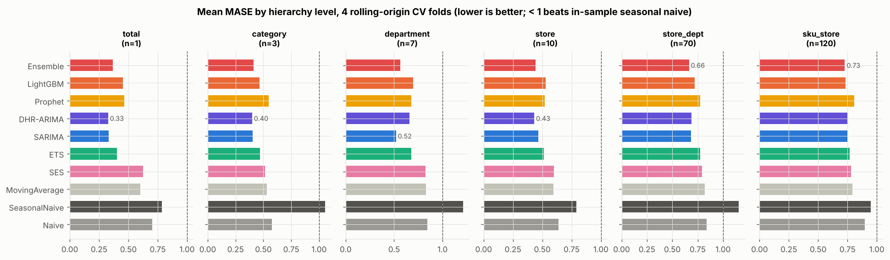

Mean MASE by level (CV):

| model | total | category | department | store | store_dept | sku_store |
|---|---|---|---|---|---|---|
| DHR-ARIMA | 0.326 | 0.398 | 0.660 | 0.431 | 0.691 | 0.754 |
| SARIMA | 0.331 | 0.405 | 0.519 | 0.466 | 0.686 | 0.751 |
| Ensemble | 0.366 | 0.410 | 0.566 | 0.442 | 0.665 | 0.727 |
| ETS | 0.404 | 0.468 | 0.677 | 0.515 | 0.776 | 0.769 |
| LightGBM | 0.453 | 0.465 | 0.696 | 0.528 | 0.720 | 0.733 |
| Prophet | 0.463 | 0.549 | 0.677 | 0.521 | 0.773 | 0.809 |
| MovingAverage | 0.602 | 0.530 | 0.828 | 0.597 | 0.820 | 0.792 |
| SES | 0.627 | 0.514 | 0.823 | 0.598 | 0.792 | 0.779 |
| Naive | 0.704 | 0.578 | 0.843 | 0.638 | 0.839 | 0.899 |
| SeasonalNaive | 0.785 | 1.053 | 1.211 | 0.792 | 1.156 | 0.950 |

Median WAPE by level (CV):

| model | total | category | department | store | store_dept | sku_store |
|---|---|---|---|---|---|---|
| DHR-ARIMA | 0.028 | 0.041 | 0.057 | 0.041 | 0.087 | 0.715 |
| SARIMA | 0.029 | 0.047 | 0.059 | 0.045 | 0.088 | 0.738 |
| Ensemble | 0.032 | 0.045 | 0.061 | 0.040 | 0.083 | 0.703 |
| ETS | 0.035 | 0.052 | 0.066 | 0.051 | 0.099 | 0.767 |
| LightGBM | 0.039 | 0.046 | 0.077 | 0.049 | 0.089 | 0.703 |
| Prophet | 0.040 | 0.054 | 0.078 | 0.047 | 0.098 | 0.814 |
| MovingAverage | 0.052 | 0.054 | 0.078 | 0.060 | 0.102 | 0.770 |
| SES | 0.054 | 0.050 | 0.079 | 0.061 | 0.097 | 0.766 |
| Naive | 0.061 | 0.053 | 0.084 | 0.059 | 0.105 | 0.833 |
| SeasonalNaive | 0.067 | 0.150 | 0.155 | 0.064 | 0.158 | 0.934 |

Mean MASE by level (holdout):

| model | total | category | department | store | store_dept | sku_store |
|---|---|---|---|---|---|---|
| DHR-ARIMA | 0.272 | 0.306 | 0.578 | 0.455 | 0.625 | 0.835 |
| Ensemble | 0.318 | 0.306 | 0.448 | 0.430 | 0.574 | 0.767 |
| LightGBM | 0.335 | 0.338 | 0.564 | 0.458 | 0.592 | 0.764 |
| SARIMA | 0.359 | 0.309 | 0.415 | 0.447 | 0.605 | 0.804 |
| ETS | 0.466 | 0.380 | 0.593 | 0.513 | 0.673 | 0.816 |
| Naive | 0.512 | 0.404 | 0.629 | 0.556 | 0.712 | 0.939 |
| MovingAverage | 0.546 | 0.398 | 0.680 | 0.542 | 0.678 | 0.828 |
| Prophet | 0.564 | 0.770 | 0.741 | 0.571 | 0.731 | 0.847 |
| SES | 0.573 | 0.427 | 0.672 | 0.555 | 0.665 | 0.826 |
| SeasonalNaive | 1.803 | 1.134 | 1.152 | 1.236 | 1.040 | 1.029 |

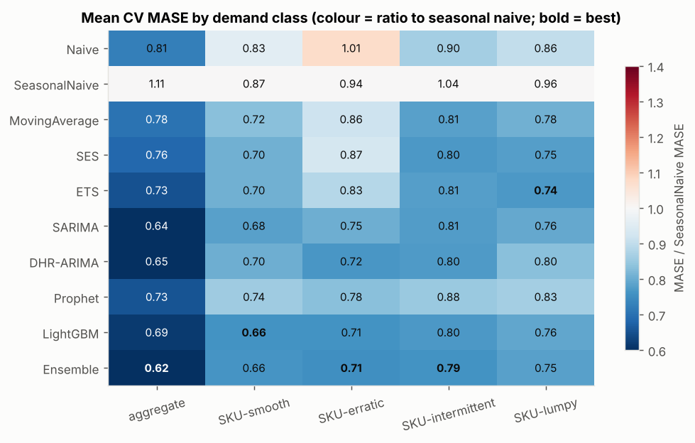

Mean MASE by demand class (CV, then holdout):

| model | aggregate (all smooth) | SKU-smooth | SKU-erratic | SKU-intermittent | SKU-lumpy |
|---|---|---|---|---|---|
| Ensemble | 0.621 | 0.661 | 0.708 | 0.790 | 0.751 |
| SARIMA | 0.636 | 0.679 | 0.753 | 0.806 | 0.764 |
| DHR-ARIMA | 0.646 | 0.697 | 0.720 | 0.801 | 0.800 |
| LightGBM | 0.686 | 0.659 | 0.711 | 0.800 | 0.761 |
| ETS | 0.725 | 0.699 | 0.830 | 0.808 | 0.739 |
| Prophet | 0.727 | 0.743 | 0.779 | 0.885 | 0.830 |
| SES | 0.762 | 0.700 | 0.870 | 0.800 | 0.747 |
| MovingAverage | 0.784 | 0.721 | 0.859 | 0.813 | 0.776 |
| Naive | 0.807 | 0.831 | 1.006 | 0.897 | 0.863 |
| SeasonalNaive | 1.113 | 0.867 | 0.936 | 1.037 | 0.959 |

| model | aggregate (all smooth) | SKU-smooth | SKU-erratic | SKU-intermittent | SKU-lumpy |
|---|---|---|---|---|---|
| Ensemble | 0.537 | 0.659 | 0.748 | 0.877 | 0.786 |
| SARIMA | 0.561 | 0.657 | 0.819 | 0.919 | 0.821 |
| LightGBM | 0.564 | 0.676 | 0.713 | 0.878 | 0.791 |
| DHR-ARIMA | 0.588 | 0.723 | 0.905 | 0.881 | 0.830 |
| ETS | 0.637 | 0.632 | 0.825 | 0.935 | 0.871 |
| SES | 0.645 | 0.633 | 0.856 | 0.927 | 0.890 |
| MovingAverage | 0.652 | 0.641 | 0.877 | 0.931 | 0.864 |
| Naive | 0.676 | 0.824 | 0.909 | 1.031 | 0.994 |
| Prophet | 0.714 | 0.802 | 0.799 | 0.903 | 0.882 |
| SeasonalNaive | 1.082 | 0.971 | 1.008 | 1.135 | 1.000 |

By seasonal-strength band (CV):

| model | moderate(0.3-0.6) | strong(>0.6) | weak(<0.3) |
|---|---|---|---|
| Ensemble | 0.638 | 0.702 | 0.701 |
| SARIMA | 0.660 | 0.724 | 0.718 |
| DHR-ARIMA | 0.662 | 0.729 | 0.728 |
| LightGBM | 0.664 | 0.787 | 0.714 |
| ETS | 0.706 | 0.880 | 0.727 |
| SES | 0.712 | 0.988 | 0.725 |
| MovingAverage | 0.736 | 1.027 | 0.728 |
| Prophet | 0.752 | 0.699 | 0.817 |
| Naive | 0.771 | 1.094 | 0.823 |
| SeasonalNaive | 0.948 | 1.038 | 1.058 |

By trend-strength band (CV):

| model | moderate(0.5-0.8) | strong(>0.8) | weak(<0.5) |
|---|---|---|---|
| Ensemble | 0.720 | 0.505 | 0.722 |
| DHR-ARIMA | 0.737 | 0.536 | 0.750 |
| SARIMA | 0.745 | 0.512 | 0.744 |
| LightGBM | 0.778 | 0.568 | 0.733 |
| ETS | 0.807 | 0.615 | 0.771 |
| SES | 0.842 | 0.676 | 0.776 |
| MovingAverage | 0.865 | 0.695 | 0.790 |
| Prophet | 0.879 | 0.553 | 0.804 |
| Naive | 0.900 | 0.696 | 0.896 |
| SeasonalNaive | 1.287 | 0.901 | 0.959 |

### 9.4 Prediction-interval coverage (share of actuals inside the interval)

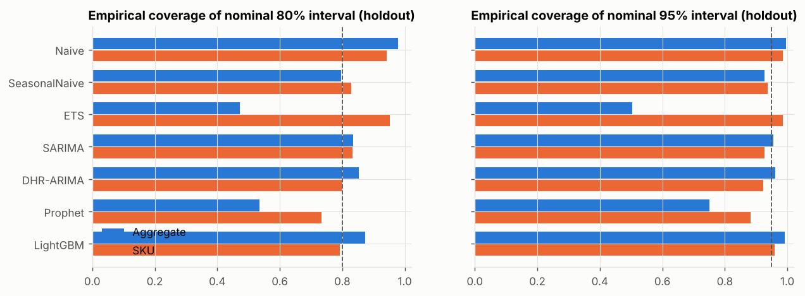

| model | group | cov80 | cov95 | n_windows | period |
|---|---|---|---|---|---|
| DHR-ARIMA | Aggregate | 0.846 | 0.955 | 364 | cv |
| DHR-ARIMA | SKU | 0.828 | 0.940 | 480 | cv |
| ETS | Aggregate | 0.498 | 0.537 | 364 | cv |
| ETS | SKU | 0.963 | 0.989 | 480 | cv |
| LightGBM | Aggregate | 0.803 | 0.951 | 364 | cv |
| LightGBM | SKU | 0.799 | 0.948 | 480 | cv |
| Naive | Aggregate | 0.948 | 0.982 | 364 | cv |
| Naive | SKU | 0.962 | 0.989 | 480 | cv |
| Prophet | Aggregate | 0.584 | 0.775 | 364 | cv |
| Prophet | SKU | 0.739 | 0.886 | 480 | cv |
| SARIMA | Aggregate | 0.826 | 0.942 | 364 | cv |
| SARIMA | SKU | 0.856 | 0.951 | 480 | cv |
| SeasonalNaive | Aggregate | 0.801 | 0.942 | 364 | cv |
| SeasonalNaive | SKU | 0.850 | 0.947 | 480 | cv |
| DHR-ARIMA | Aggregate | 0.854 | 0.961 | 91 | holdout |
| DHR-ARIMA | SKU | 0.798 | 0.922 | 120 | holdout |
| ETS | Aggregate | 0.473 | 0.503 | 91 | holdout |
| ETS | SKU | 0.952 | 0.987 | 120 | holdout |
| LightGBM | Aggregate | 0.873 | 0.991 | 91 | holdout |
| LightGBM | SKU | 0.792 | 0.960 | 120 | holdout |
| Naive | Aggregate | 0.979 | 0.996 | 91 | holdout |
| Naive | SKU | 0.942 | 0.986 | 120 | holdout |
| Prophet | Aggregate | 0.535 | 0.750 | 91 | holdout |
| Prophet | SKU | 0.734 | 0.883 | 120 | holdout |
| SARIMA | Aggregate | 0.834 | 0.956 | 91 | holdout |
| SARIMA | SKU | 0.832 | 0.926 | 120 | holdout |
| SeasonalNaive | Aggregate | 0.797 | 0.927 | 91 | holdout |
| SeasonalNaive | SKU | 0.829 | 0.938 | 120 | holdout |

SARIMA, DHR-ARIMA, LightGBM (empirical intervals) and seasonal naive are near nominal. **ETS under-covers badly on
aggregates (≈ 50% for a nominal 80%)** and so does **Prophet (≈ 58%)**; ETS over-covers on SKUs. Using such
intervals for safety stock would be dangerous, so calibration must be measured, not assumed.

### 9.5 Statistical comparison
Paired bootstrap across series of the mean CV MASE difference (A − B; negative = A better; 5,000 resamples, series
as the resampling unit):

| model_a | model_b | group | mean_diff | ci95_lo | ci95_hi | n_series | share_a_better | wilcoxon_p |
|---|---|---|---|---|---|---|---|---|
| Ensemble | DHR-ARIMA | all | -0.0263 | -0.0410 | -0.0110 | 211 | 0.5877 | 0.0013 |
| Ensemble | DHR-ARIMA | Aggregates | -0.0251 | -0.0493 | -0.0029 | 91 | 0.5934 | 0.0687 |
| Ensemble | DHR-ARIMA | SKU | -0.0272 | -0.0481 | -0.0060 | 120 | 0.5833 | 0.0083 |
| Ensemble | SARIMA | all | -0.0198 | -0.0295 | -0.0107 | 211 | 0.6777 | 0.0000 |
| Ensemble | SARIMA | Aggregates | -0.0151 | -0.0296 | -0.0010 | 91 | 0.6154 | 0.0149 |
| Ensemble | SARIMA | SKU | -0.0233 | -0.0362 | -0.0107 | 120 | 0.7250 | 0.0000 |
| LightGBM | SeasonalNaive | all | -0.3077 | -0.3627 | -0.2599 | 211 | 0.8436 | 0.0000 |
| LightGBM | SeasonalNaive | Aggregates | -0.4272 | -0.5315 | -0.3384 | 91 | 0.8462 | 0.0000 |
| LightGBM | SeasonalNaive | SKU | -0.2170 | -0.2588 | -0.1775 | 120 | 0.8417 | 0.0000 |
| SARIMA | DHR-ARIMA | all | -0.0065 | -0.0228 | 0.0102 | 211 | 0.5024 | 0.5787 |
| SARIMA | DHR-ARIMA | Aggregates | -0.0100 | -0.0345 | 0.0122 | 91 | 0.4615 | 0.9243 |
| SARIMA | DHR-ARIMA | SKU | -0.0039 | -0.0261 | 0.0204 | 120 | 0.5333 | 0.4860 |
| SARIMA | ETS | all | -0.0489 | -0.0696 | -0.0300 | 211 | 0.6019 | 0.0000 |
| SARIMA | ETS | Aggregates | -0.0892 | -0.1207 | -0.0595 | 91 | 0.7143 | 0.0000 |
| SARIMA | ETS | SKU | -0.0184 | -0.0431 | 0.0053 | 120 | 0.5167 | 0.4275 |
| SARIMA | LightGBM | all | -0.0112 | -0.0302 | 0.0085 | 211 | 0.4692 | 0.7051 |
| SARIMA | LightGBM | Aggregates | -0.0496 | -0.0836 | -0.0169 | 91 | 0.5934 | 0.0067 |
| SARIMA | LightGBM | SKU | 0.0178 | -0.0043 | 0.0401 | 120 | 0.3750 | 0.0355 |
| SARIMA | SeasonalNaive | all | -0.3189 | -0.3798 | -0.2661 | 211 | 0.8815 | 0.0000 |
| SARIMA | SeasonalNaive | Aggregates | -0.4768 | -0.5902 | -0.3813 | 91 | 0.9451 | 0.0000 |
| SARIMA | SeasonalNaive | SKU | -0.1992 | -0.2415 | -0.1578 | 120 | 0.8333 | 0.0000 |

Per-series Diebold-Mariano tests (absolute-error loss, HLN correction, autocovariance to lag 12, 65 forecast
weeks per series):

| model_a | model_b | group | A significantly better | B significantly better | no significant difference |
|---|---|---|---|---|---|
| Ensemble | DHR-ARIMA | Aggregate | 12 | 3 | 76 |
| Ensemble | DHR-ARIMA | SKU | 20 | 5 | 95 |
| Ensemble | SARIMA | Aggregate | 13 | 5 | 73 |
| Ensemble | SARIMA | SKU | 17 | 6 | 97 |
| LightGBM | SeasonalNaive | Aggregate | 40 | 0 | 51 |
| LightGBM | SeasonalNaive | SKU | 53 | 2 | 65 |
| SARIMA | DHR-ARIMA | Aggregate | 9 | 2 | 80 |
| SARIMA | DHR-ARIMA | SKU | 13 | 9 | 98 |
| SARIMA | ETS | Aggregate | 19 | 1 | 71 |
| SARIMA | ETS | SKU | 7 | 7 | 106 |
| SARIMA | LightGBM | Aggregate | 11 | 5 | 75 |
| SARIMA | LightGBM | SKU | 9 | 12 | 99 |
| SARIMA | SeasonalNaive | Aggregate | 43 | 1 | 47 |
| SARIMA | SeasonalNaive | SKU | 41 | 3 | 76 |

*Meaning:* group-level differences between the top models are real but small; at the level of a single series,
most differences are within noise. On the TOTAL series alone, SARIMA vs DHR-ARIMA (p = 0.10) and Ensemble vs SARIMA
(p = 0.21) are not significant; SARIMA beats seasonal naive (p = 0.044) and ETS (p = 0.030).

### 9.6 Fold-by-fold stability
Mean MASE per origin:

| model | cv1 | cv2 | cv3 | cv4 | holdout |
|---|---|---|---|---|---|
| Naive | 0.841 | 0.838 | 0.863 | 0.896 | 0.826 |
| SeasonalNaive | 1.029 | 1.002 | 1.017 | 1.031 | 1.051 |
| MovingAverage | 0.720 | 0.781 | 0.808 | 0.846 | 0.752 |
| SES | 0.700 | 0.795 | 0.789 | 0.803 | 0.748 |
| ETS | 0.729 | 0.769 | 0.739 | 0.764 | 0.739 |
| SARIMA | 0.690 | 0.734 | 0.694 | 0.687 | 0.699 |
| DHR-ARIMA | 0.698 | 0.726 | 0.693 | 0.714 | 0.728 |
| Prophet | 0.758 | 0.807 | 0.781 | 0.749 | 0.789 |
| LightGBM | 0.669 | 0.728 | 0.712 | 0.741 | 0.678 |
| Ensemble | 0.656 | 0.713 | 0.679 | 0.677 | 0.668 |

Median WAPE per origin:

| model | cv1 | cv2 | cv3 | cv4 | holdout |
|---|---|---|---|---|---|
| Naive | 0.400 | 0.393 | 0.426 | 0.375 | 0.347 |
| SeasonalNaive | 0.491 | 0.467 | 0.462 | 0.443 | 0.484 |
| MovingAverage | 0.365 | 0.341 | 0.373 | 0.371 | 0.299 |
| SES | 0.339 | 0.362 | 0.366 | 0.350 | 0.293 |
| ETS | 0.338 | 0.341 | 0.359 | 0.350 | 0.298 |
| SARIMA | 0.341 | 0.373 | 0.373 | 0.333 | 0.278 |
| DHR-ARIMA | 0.342 | 0.350 | 0.403 | 0.326 | 0.424 |
| Prophet | 0.404 | 0.426 | 0.439 | 0.389 | 0.382 |
| LightGBM | 0.341 | 0.343 | 0.371 | 0.333 | 0.323 |
| Ensemble | 0.338 | 0.351 | 0.368 | 0.309 | 0.301 |

### 9.7 LightGBM: what it uses, and the price-assumption ablation

| feature | gain_share |
|---|---|
| slag104 | 0.267 |
| store_c | 0.086 |
| price_rel52 | 0.064 |
| rmean4 | 0.062 |
| slope26 | 0.059 |
| woy | 0.059 |
| zero52 | 0.049 |
| age | 0.047 |
| scale_log | 0.038 |
| rstd52 | 0.035 |
| yoy13 | 0.026 |
| snap | 0.023 |

| period | group | no_price | with_price |
|---|---|---|---|
| cv | Aggregate | 0.6915 | 0.6855 |
| cv | SKU | 0.7408 | 0.7327 |
| holdout | Aggregate | 0.5718 | 0.5636 |
| holdout | SKU | 0.7647 | 0.7644 |

Without the target-week price features, LightGBM's mean MASE moves by less than 0.01 in every group/period, so
**no conclusion depends on the "planned price is known" assumption.** (The "with_price" numbers reproduce the main
run exactly, an incidental determinism check.)

---

## 10. Why each model works where it does (and not elsewhere)

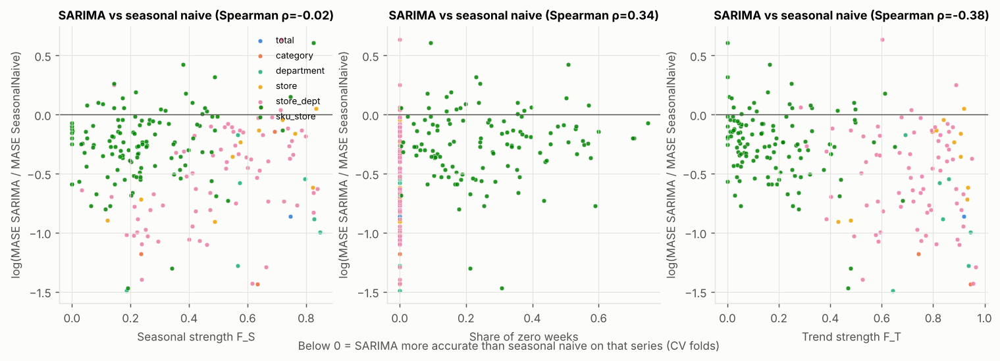

Binned win rates and median MASE by series characteristic (CV):

| feature | bin | n | sarima_beats_snaive | sarima_beats_lgbm | sarima_beats_ets | median_mase_SARIMA | median_mase_LightGBM | median_mase_ETS | median_mase_DHR | median_mase_SeasonalNaive |
|---|---|---|---|---|---|---|---|---|---|---|
| seasonal_strength | (-0.01, 0.2] | 60 | 0.867 | 0.383 | 0.500 | 0.634 | 0.575 | 0.614 | 0.625 | 0.889 |
| seasonal_strength | (0.2, 0.4] | 64 | 0.922 | 0.438 | 0.484 | 0.614 | 0.571 | 0.617 | 0.647 | 0.903 |
| seasonal_strength | (0.4, 0.6] | 46 | 0.891 | 0.457 | 0.674 | 0.653 | 0.624 | 0.645 | 0.643 | 0.920 |
| seasonal_strength | (0.6, 1.0] | 41 | 0.829 | 0.659 | 0.854 | 0.702 | 0.814 | 0.909 | 0.774 | 1.042 |
| share_zeros | (-0.01, 0.0001] | 91 | 0.945 | 0.593 | 0.714 | 0.527 | 0.560 | 0.603 | 0.545 | 0.976 |
| share_zeros | (0.0001, 0.2] | 54 | 0.815 | 0.315 | 0.593 | 0.691 | 0.651 | 0.663 | 0.690 | 0.879 |
| share_zeros | (0.2, 0.4] | 42 | 0.833 | 0.476 | 0.524 | 0.658 | 0.636 | 0.710 | 0.599 | 0.891 |
| share_zeros | (0.4, 1.0] | 24 | 0.875 | 0.333 | 0.333 | 0.784 | 0.734 | 0.784 | 0.784 | 1.098 |
| trend_strength | (-0.01, 0.3] | 98 | 0.847 | 0.378 | 0.561 | 0.731 | 0.715 | 0.750 | 0.749 | 0.920 |
| trend_strength | (0.3, 0.6] | 42 | 0.881 | 0.476 | 0.452 | 0.613 | 0.609 | 0.625 | 0.611 | 0.903 |
| trend_strength | (0.6, 0.8] | 32 | 0.906 | 0.594 | 0.656 | 0.540 | 0.593 | 0.610 | 0.545 | 1.054 |
| trend_strength | (0.8, 1.0] | 39 | 0.949 | 0.590 | 0.821 | 0.474 | 0.499 | 0.585 | 0.428 | 0.806 |
| cv | (0.0, 0.25] | 57 | 0.947 | 0.561 | 0.649 | 0.527 | 0.564 | 0.601 | 0.544 | 0.971 |
| cv | (0.25, 0.6] | 42 | 0.905 | 0.571 | 0.738 | 0.582 | 0.602 | 0.634 | 0.644 | 0.967 |
| cv | (0.6, 1.0] | 51 | 0.902 | 0.373 | 0.588 | 0.641 | 0.568 | 0.647 | 0.652 | 0.888 |
| cv | (1.0, 10.0] | 61 | 0.787 | 0.393 | 0.475 | 0.737 | 0.722 | 0.753 | 0.763 | 0.893 |

By class:

| cls | n | sarima_beats_snaive | sarima_beats_lgbm | sarima_beats_ets | sarima_best_or_within5pct | seasonal_strength | share_zeros | trend_strength |
|---|---|---|---|---|---|---|---|---|
| SKU-erratic | 30 | 0.733 | 0.333 | 0.600 | 0.200 | 0.190 | 0.146 | 0.155 |
| SKU-intermittent | 30 | 0.900 | 0.533 | 0.467 | 0.233 | 0.205 | 0.374 | 0.115 |
| SKU-lumpy | 30 | 0.833 | 0.267 | 0.400 | 0.167 | 0.168 | 0.361 | 0.052 |
| SKU-smooth | 30 | 0.867 | 0.367 | 0.600 | 0.333 | 0.239 | 0.094 | 0.244 |
| category | 3 | 1.000 | 0.667 | 0.667 | 0.333 | 0.634 | 0.000 | 0.796 |
| department | 7 | 1.000 | 0.857 | 1.000 | 0.714 | 0.573 | 0.000 | 0.838 |
| store | 10 | 0.900 | 0.600 | 0.800 | 0.200 | 0.607 | 0.000 | 0.893 |
| store_dept | 70 | 0.943 | 0.557 | 0.671 | 0.371 | 0.531 | 0.000 | 0.744 |
| total | 1 | 1.000 | 1.000 | 1.000 | 1.000 | 0.746 | 0.000 | 0.919 |

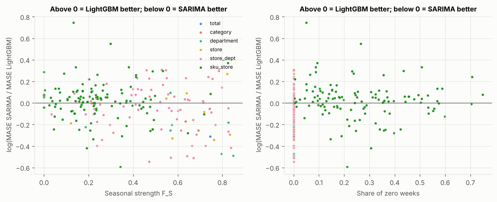
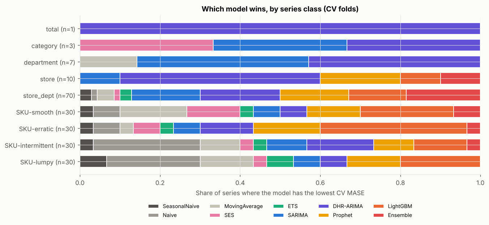

Number of series won (lowest CV MASE) by class:

| row_0 | DHR-ARIMA | ETS | Ensemble | LightGBM | MovingAverage | Naive | Prophet | SARIMA | SES | SeasonalNaive |
|---|---|---|---|---|---|---|---|---|---|---|
| SKU-erratic | 4 | 1 | 1 | 11 | 1 | 2 | 5 | 2 | 2 | 1 |
| SKU-intermittent | 5 | 1 | 1 | 4 | 3 | 8 | 3 | 3 | 1 | 1 |
| SKU-lumpy | 2 | 2 | 0 | 6 | 4 | 7 | 4 | 2 | 1 | 2 |
| SKU-smooth | 2 | 1 | 2 | 7 | 5 | 2 | 4 | 2 | 4 | 1 |
| category | 1 | 0 | 0 | 0 | 0 | 0 | 0 | 1 | 1 | 0 |
| department | 3 | 0 | 0 | 0 | 1 | 0 | 0 | 3 | 0 | 0 |
| store | 5 | 0 | 1 | 1 | 0 | 0 | 2 | 1 | 0 | 0 |
| store_dept | 14 | 2 | 13 | 10 | 3 | 1 | 12 | 12 | 1 | 2 |
| total | 1 | 0 | 0 | 0 | 0 | 0 | 0 | 0 | 0 | 0 |

### 10.1 SARIMA
- **Wins where** series are aggregates (no zeros), with strong trend and seasonality and long, mostly stable
  history. Its win rate vs LightGBM rises from 38% (F_S ≤ 0.2) to 66% (F_S > 0.6), and vs ETS from 50% to 85%. On
  zero-free series it beats LightGBM 59% of the time; with trend strength > 0.8, 59% (and ETS 82%). It is the best
  model at department level (0.519) and the best single model on aggregates (0.636), with calibrated intervals.
- **Loses where** demand is SKU-level and zero-inflated: with zeros it beats LightGBM on only 32-48% of series.
  ARIMA assumes continuous, roughly Gaussian errors and linear autocorrelation, but weekly SKU demand with 24-37%
  zeros has little such structure (median F_S ≈ 0.2), and AutoARIMA selects seasonal differencing on only 1.7% of
  SKU fits. On 4 strongly seasonal SKUs it was the worst of the top models (mean MASE 1.03 vs Prophet 0.79), a
  small-n hint that lag-52 terms estimated from ~4 noisy repetitions overfit noise.
- **Contradiction with the textbook, investigated.** One would expect SARIMA's edge over *seasonal naive* to grow
  with seasonal strength. It does not (it wins 83-92% in every seasonal band) because seasonal naive's problem here
  is trend, not seasonality: with growth, last year's level is always too low (median aggregate bias −11.6%).

### 10.2 LightGBM (global)
- **Wins where** there are many related, noisy series: best single model on SKUs (0.733), especially erratic (0.711)
  and smooth (0.659) SKUs. It pools patterns across 211 series, uses exogenous drivers (SNAP, events, price), and
  makes no distributional assumption about zeros.
- **Loses where** series are strongly trending aggregates (ΔMASE −0.050 in SARIMA's favour, significant). Trees
  predict leaf averages and cannot extrapolate beyond the training range; the trailing-mean scaling helps, but each
  aggregate's specific autocorrelation is better captured by a per-series model. It is also sensitive to the
  fold: best single model in cv1 (0.669), worst of the top four in cv4 (0.741).
- **Leakage-prone design was avoided** by construction and by test (section 7.1).

### 10.3 DHR-ARIMA, ETS, Prophet, baselines
- **DHR-ARIMA** ties SARIMA overall and wins most store and total series (store 0.431 vs SARIMA 0.466; total 0.326
  vs 0.331): explicit SNAP and holiday regressors pay off on large FOODS-heavy aggregates. It has fewer parameters
  for the annual cycle than SARIMA's lag-52 structure and uses the correct 52.18-week period.
- **ETS** is significantly worse than SARIMA on aggregates (−0.089) and badly calibrated there (50% coverage of
  80% intervals), because it must carry 52 seasonal states. It is the **best model on lumpy SKUs (0.739)**, where
  heavy smoothing of a noisy level is what matters.
- **Prophet** is mid-table overall (0.774) with the most negative SKU bias (−12.9%), since it ignores short-term
  autocorrelation. But it has the **best mean MASE in the strong-seasonality band (0.699, 41 series)**, driven by
  store x department and the few strongly seasonal SKUs. Smooth Fourier seasonality is robust when the seasonal
  pattern is strong but noisy.
- **Naive / moving average** win a share of intermittent and lumpy SKUs (naive wins 8 of 30 intermittent SKUs):
  when demand is mostly noise, the simplest level estimate is hard to beat.
- **Seasonal naive** is last (MASE 1.020) because of growth.

### 10.4 Where the choice does not matter
The CV-best model is also the holdout-best model on only **12.8%** of series. A depth-3 decision tree predicts the
per-series winner with **20.4%** accuracy vs **18.5%** for always guessing the most common winner. For SARIMA vs
LightGBM, 75/91 aggregates and 99/120 SKUs show no significant per-series DM difference. **Choosing a different
model for every series is mostly fitting noise.** Robust choices are made per *group*, and combining models (the
Ensemble) captures most of the benefit.

### 10.5 Decision guide
| Given a series that is… | prefer | because (evidence in this study) |
|---|---|---|
| an aggregate (store/department/category), zero-free, trend & seasonal strength > 0.5 | **SARIMA** or **DHR-ARIMA** | best single models on aggregates (0.636 / 0.646), significantly better than LightGBM (−0.050) and ETS (−0.089), calibrated intervals |
| a large aggregate with known calendar drivers (SNAP, moving holidays) | **DHR-ARIMA** | best on total/category/store; correct 52.18-week period |
| one of many related SKU series with zeros and weak seasonality | **global LightGBM** | best single model on SKUs (0.733); still 0.741 without price features |
| lumpy (ADI ≥ 1.32 and CV² ≥ 0.49) | **ETS/SES** or the ensemble | ETS best on lumpy SKUs (0.739) |
| strongly seasonal but noisy | **Prophet** is worth a try | best in the F_S > 0.6 band (0.699) |
| anything, if you can deploy only one approach | **Ensemble (SARIMA + LightGBM)** | best overall in CV (0.681) and holdout (0.668); better than SARIMA on 68% of series |
| strongly trending | **not** seasonal naive | MASE 1.11 on aggregates, −11.6% bias |

---

## 11. Final forecast

Each series is forecast with the model that had the best mean CV MASE at its level (DHR-ARIMA for
total/category/store, SARIMA for departments, Ensemble for store x department and SKUs), refit on all 277 weeks.
13 weeks: 2016-05-21 to 2016-08-13. All candidates' forecasts are in `outputs/forecasts.csv` (flag `recommended`).

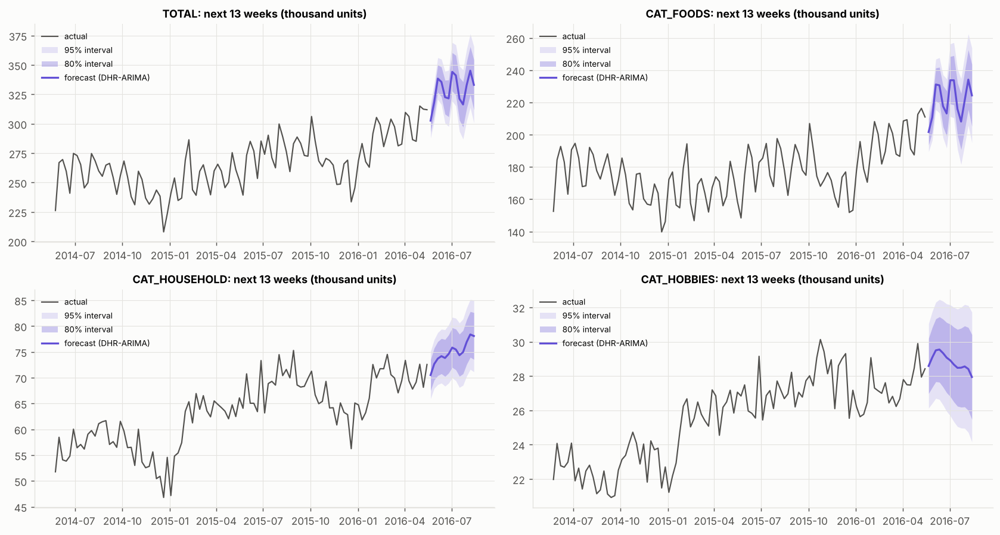

| unique_id | model | total_13w | peak_week | last_13w_actual | same_13w_last_year_actual | vs_same_period_last_year_pct |
|---|---|---|---|---|---|---|
| CAT_FOODS | DHR-ARIMA | 2876614.1 | 2016-08-06 | 2590528.0 | 2340820.0 | 22.9 |
| CAT_HOBBIES | DHR-ARIMA | 374588.5 | 2016-06-11 | 358220.0 | 347978.0 | 7.6 |
| CAT_HOUSEHOLD | DHR-ARIMA | 973404.6 | 2016-08-06 | 916234.0 | 888029.0 | 9.6 |
| TOTAL | DHR-ARIMA | 4273601.7 | 2016-08-06 | 3864982.0 | 3576827.0 | 19.5 |

**What it says:** about 4.27 M units over the next 13 weeks for the total, +19.5% vs the same weeks of 2015. That
is consistent with the momentum in the data (the last 13 actual weeks were already +16.2% year on year) and with
the other strong models (SARIMA, ETS and the Ensemble give similar weekly levels of 289k-348k). FOODS drives the
growth (+22.9%); HOUSEHOLD +9.6%, HOBBIES +7.6%. Weekly peaks fall in the first week of each month (SNAP) and in
early August.
**What it does not say:** nothing about future promotions, price changes (prices are held constant), competitor
actions, supply problems or store openings. The intervals only reflect variability seen in the past. At aggregate
level the CV evidence suggests ~2-4% WAPE on a 13-week quarter for the total and roughly calibrated 80% intervals
for SARIMA/DHR.

---

## 12. Inventory optimization (SIMULATED)

### 12.1 Method
- **Policy:** periodic review every R = 1 week, order-up-to level S_t, lost sales (customers do not wait), lead
  time L. S_t = forecast demand over the protection interval L + R + safety stock.
- **Safety stock** SS = z · σ · √(L + R); **reorder point** (continuous-review view) ROP = forecast over L +
  z · σ · √L; z = Φ⁻¹(service level), e.g. 1.645 for 95%.
- **σ = RMSE of the model's own CV forecast errors at horizons 1-4** (16 errors per series), **not** the standard
  deviation of demand. The forecast already explains the predictable part (trend, seasonality, SNAP), so only the
  unexplained part needs a buffer. A better forecaster is rewarded twice: better cycle stock and a smaller buffer.
- **Assumptions (stated in `config/config.yaml`):** lead time L ∈ {1,2,3,4} weeks (M5 has none), service level ∈
  {90, 95, 98}%, holding cost 1 per unit-week, shortage cost 9 per lost unit (critical ratio 0.9). Default
  L = 2, SL = 95%.
- **Back-test:** the 13 holdout weeks. Each week the forecast is updated with the latest actual (rolling origin,
  horizons 1..L+1) without re-estimating parameters, as a weekly replenishment run would do (SARIMA via
  `forward()`, LightGBM via refreshed features). Policies are driven by naive, seasonal naive, SARIMA, LightGBM and
  the Ensemble, plus "Ensemble + demand-sigma" (same forecasts, σ = demand standard deviation) to test the σ choice.
  Initial stock = SS plus pipeline orders equal to the first forecasts, identical across policies.

### 12.2 Results (L = 2 weeks, 95% service)

| group | policy | fill_rate | stockout_rate | avg_on_hand | safety_stock | lost_units | total_cost | total_cost_vs_SeasonalNaive_pct | avg_on_hand_vs_SeasonalNaive_pct |
|---|---|---|---|---|---|---|---|---|---|
| SKU | Ensemble | 0.936 | 0.072 | 2071.813 | 1782.813 | 913.478 | 35154.878 | -42.833 | -44.003 |
| SKU | Ensemble + demand-sigma | 0.952 | 0.058 | 2408.897 | 2168.297 | 675.988 | 37399.549 | -39.183 | -34.892 |
| SKU | LightGBM | 0.943 | 0.071 | 2157.705 | 1858.656 | 814.662 | 35382.123 | -42.464 | -41.681 |
| SKU | Naive | 0.950 | 0.048 | 2931.468 | 2214.326 | 713.996 | 44535.046 | -27.580 | -20.768 |
| SKU | SARIMA | 0.932 | 0.076 | 2218.272 | 1909.475 | 969.516 | 37563.183 | -38.917 | -40.044 |
| SKU | SeasonalNaive | 0.895 | 0.097 | 3699.838 | 3314.831 | 1488.626 | 61495.521 | 0.000 | 0.000 |
| store_dept | Ensemble | 0.994 | 0.076 | 75287.240 | 68792.669 | 22578.017 | 1181936.275 | -55.361 | 29.007 |
| store_dept | Ensemble + demand-sigma | 0.998 | 0.046 | 95822.517 | 92133.511 | 8647.934 | 1323524.133 | -50.014 | 64.195 |
| store_dept | LightGBM | 0.995 | 0.065 | 95265.329 | 82872.773 | 19942.519 | 1417931.958 | -46.448 | 63.240 |
| store_dept | Naive | 0.978 | 0.124 | 96379.167 | 84674.660 | 83829.027 | 2007390.415 | -24.186 | 65.149 |
| store_dept | SARIMA | 0.992 | 0.096 | 67614.964 | 66089.903 | 32226.752 | 1169035.298 | -55.848 | 15.861 |
| store_dept | SeasonalNaive | 0.946 | 0.249 | 58358.937 | 126978.100 | 209900.050 | 2647766.633 | 0.000 | 0.000 |

**SKUs (120):** the Ensemble policy's cost proxy is **42.8% lower** than seasonal naive's, with fill rate **93.6% vs
89.5%** and 44% less average stock. LightGBM −42.5%, SARIMA −38.9%. Naive reaches the highest fill rate (95.0%)
but holds 41% more stock than the Ensemble policy.
**Store x department (70):** Ensemble −55.4%, SARIMA −55.8%, LightGBM −46.4% vs seasonal naive, whose −11%
growth bias produces a 24.9% weekly stock-out rate.
**σ choice:** sizing safety stock on demand variability instead of forecast error raises store x department safety
stock by 34% (92k vs 69k units) and average stock by 27%, with a marginal fill gain (99.8% vs 99.4%) and a 12%
higher cost proxy.

### 12.3 Sensitivity (cost proxy vs the seasonal-naive policy, %)

| group | service_level | lead_time | Ensemble | LightGBM | Naive | SARIMA |
|---|---|---|---|---|---|---|
| SKU | 0.9 | 1 | -42.2 | -40.3 | -30.6 | -39.5 |
| SKU | 0.9 | 2 | -42.0 | -41.6 | -27.1 | -38.6 |
| SKU | 0.9 | 3 | -41.7 | -40.6 | -22.5 | -38.2 |
| SKU | 0.9 | 4 | -40.8 | -39.9 | -18.8 | -37.0 |
| SKU | 0.9 | 1 | -42.2 | -41.1 | -29.5 | -39.0 |
| SKU | 0.9 | 2 | -42.8 | -42.5 | -27.6 | -38.9 |
| SKU | 0.9 | 3 | -42.0 | -41.1 | -22.8 | -38.2 |
| SKU | 0.9 | 4 | -41.6 | -40.6 | -19.9 | -37.1 |
| SKU | 1.0 | 1 | -42.9 | -42.0 | -28.5 | -39.0 |
| SKU | 1.0 | 2 | -43.4 | -42.3 | -26.9 | -39.2 |
| SKU | 1.0 | 3 | -42.2 | -41.0 | -22.8 | -38.0 |
| SKU | 1.0 | 4 | -42.2 | -41.0 | -20.4 | -37.5 |
| store_dept | 0.9 | 1 | -65.6 | -60.6 | -38.8 | -65.4 |
| store_dept | 0.9 | 2 | -62.3 | -55.4 | -27.9 | -61.1 |
| store_dept | 0.9 | 3 | -61.4 | -55.6 | -32.0 | -59.6 |
| store_dept | 0.9 | 4 | -59.0 | -53.7 | -27.2 | -55.6 |
| store_dept | 0.9 | 1 | -57.5 | -49.4 | -31.6 | -58.6 |
| store_dept | 0.9 | 2 | -55.4 | -46.4 | -24.2 | -55.8 |
| store_dept | 0.9 | 3 | -55.0 | -46.9 | -27.8 | -54.8 |
| store_dept | 0.9 | 4 | -52.5 | -44.5 | -22.2 | -49.9 |
| store_dept | 1.0 | 1 | -47.0 | -35.2 | -22.9 | -50.1 |
| store_dept | 1.0 | 2 | -46.3 | -35.0 | -19.2 | -48.6 |
| store_dept | 1.0 | 3 | -46.6 | -36.4 | -22.6 | -48.3 |
| store_dept | 1.0 | 4 | -43.8 | -33.4 | -16.3 | -43.0 |

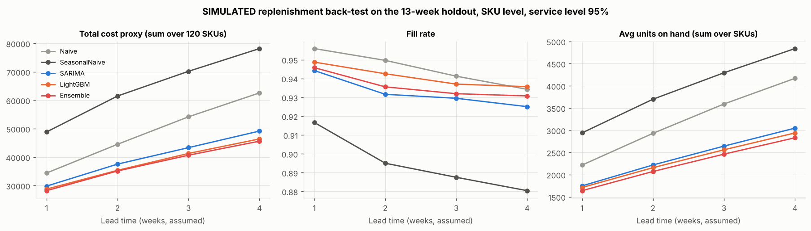

The ranking is identical in all 24 group x lead-time x service-level cells: SKU savings 37-43%, store x department
43-66% (SARIMA and Ensemble are the strongest at store x department, the Ensemble and LightGBM at SKU).

### 12.4 Honest reading
1. Much of the gain vs seasonal naive comes from that baseline's growth bias in a quarter that was +16% YoY.
   Against the naive policy the gain is smaller (Ensemble cost 21% below naive at SKU level: 35.2k vs 44.5k).
2. **The service target is under-delivered at SKU level:** at 95%, model-driven policies stock out in 6.1-7.9% of
   SKU-weeks instead of 5%. Reasons: σ comes from only 16 errors per series; the √(L + R) rule assumes independent
   weekly errors (multi-step errors are positively correlated); censored zero runs understate variability; and
   13 weeks is a short window. With real data, one would estimate σ for the protection interval directly from
   rolling backtests and check empirical service by segment.
3. These are **simulated** outcomes under assumed costs and lead times, not realised savings.

### 12.5 At-risk series and actions

| level | risk | n |
|---|---|---|
| SKU | OVERSTOCK RISK | 45 |
| SKU | STOCK-OUT RISK | 55 |
| SKU | ok | 20 |
| store_dept | OVERSTOCK RISK | 4 |
| store_dept | STOCK-OUT RISK | 2 |
| store_dept | ok | 64 |

Top stock-out risks (simulated fill < 90% or CV bias < −10%):

| unique_id | sbc_class | cv_bias | sim_fill_rate | safety_stock | reorder_point | order_up_to_level |
|---|---|---|---|---|---|---|
| SKU_FOODS_2_029_WI_2 | lumpy | -0.39 | 0.76 | 27.53 | 64.61 | 101.19 |
| SKU_HOUSEHOLD_2_054_WI_3 | erratic | -0.59 | 1.00 | 4.41 | 13.21 | 18.78 |
| SKU_FOODS_3_757_CA_1 | intermittent | -0.16 | 0.72 | 14.73 | 107.46 | 155.50 |
| SKU_HOUSEHOLD_2_176_CA_3 | smooth | -0.26 | 0.84 | 21.36 | 135.28 | 193.90 |
| SKU_FOODS_3_594_TX_3 | erratic | -0.40 | 1.00 | 72.07 | 83.70 | 114.86 |
| SKU_FOODS_1_110_TX_3 | smooth | 0.14 | 0.61 | 27.05 | 104.79 | 143.71 |
| SKU_HOBBIES_2_113_WI_1 | lumpy | -0.38 | 1.00 | 7.28 | 8.63 | 11.24 |
| SKU_HOBBIES_1_133_CA_3 | smooth | 0.22 | 0.62 | 2.26 | 9.46 | 14.12 |

Top overstock risks (> 3 weeks of cover or CV bias > +10%):

| unique_id | sbc_class | cv_bias | sim_weeks_of_cover | safety_stock | reorder_point | order_up_to_level |
|---|---|---|---|---|---|---|
| SKU_FOODS_1_197_WI_3 | intermittent | 0.86 | 15.51 | 1.41 | 2.24 | 3.12 |
| SKU_FOODS_2_032_TX_3 | intermittent | 0.23 | 18.66 | 11.85 | 24.58 | 34.80 |
| SKU_FOODS_2_229_CA_3 | lumpy | 0.24 | 17.53 | 6.43 | 13.38 | 18.17 |
| SKU_HOUSEHOLD_2_198_CA_4 | intermittent | 1.25 | 3.72 | 2.19 | 3.76 | 5.17 |
| SKU_HOUSEHOLD_2_207_TX_3 | intermittent | 0.63 | 9.44 | 1.75 | 2.75 | 3.75 |
| SKU_HOBBIES_2_019_CA_2 | lumpy | -0.10 | 14.62 | 2.95 | 3.61 | 4.61 |
| SKU_HOUSEHOLD_2_138_CA_1 | intermittent | 0.42 | 10.00 | 3.25 | 5.22 | 7.04 |
| SKU_FOODS_3_271_TX_3 | erratic | -0.02 | 12.46 | 14.85 | 19.31 | 24.84 |

**Merchandising/replenishment reading:** stock-out risks are mostly lumpy/erratic SKUs whose forecasts run low.
Action: raise their safety factor, check for unrecorded stock-outs, and set presentation minimums. Overstock risks
are slow intermittent SKUs where one unit is many weeks of demand. Action: a min/max or order-multiple rule, an
intermittent-demand method (Croston/TSB), or range rationalisation.

---

## 13. Limitations and threats to validity
1. **Public, non-apparel US data.** Methods transfer; numbers do not. Fashion adds short life-cycles, size curves,
   markdowns and cold starts.
2. **Censoring.** Sales ≠ demand; suspected stock-outs in 59/120 SKUs bias forecasts and σ downward.
3. **No promotions** and few price changes; no causal price/promo model.
4. **Inventory is simulated** with assumed lead times, costs, review period and initial stock, on a 13-week window.
5. **Small differences.** Top models differ by ~0.01-0.05 MASE; most per-series differences are not significant.
6. **Sample design.** 120 SKUs stratified by class (not representative of SKU volume shares); SKUs need ≥ 200
   listed weeks, so new items are excluded.
7. **Characteristics** were computed on all pre-holdout data, so for the earliest CV folds they include some
   later weeks. They are used only for *explaining* results, never as model inputs.
8. **Computation shortcuts:** AutoARIMA's CSS approximation; DHR's K fixed per series from pre-CV data; ETS
   heuristic seasonal initialisation (which probably explains part of its interval under-coverage).
9. **Single dataset period** (2011-2016), including a strong-growth phase that penalises seasonal naive.

---

## 14. Conclusions and next steps with real company data
**Conclusions.** (1) SARIMA earns its reputation on seasonal, trending aggregate series, where it is the best
single model with calibrated intervals; a Fourier/holiday regression with ARIMA errors is equally good. (2) On
noisy SKU demand a global LightGBM is better, and on lumpy items simple smoothing competes. (3) Combining SARIMA
and LightGBM is the most robust single choice. (4) Seasonal naive is a misleading baseline in a growth period.
(5) Forecast-error-based safety stock is cheaper than demand-based safety stock, and accuracy gains translate into
large simulated inventory improvements, but service targets must be verified, not assumed.

**With real Trent-style data I would:**
1. **Hierarchical reconciliation** (MinT / bottom-up / middle-out) so that store x category x SKU forecasts add up,
   using the aggregate-strength of SARIMA/DHR and the SKU-strength of the global model.
2. **Promotion and markdown modelling**: promo calendars, discount depth, display/space, and price elasticity per
   category; causal features in the global model.
3. **New-product cold start**: attribute-based models (fabric, fit, colour, price band) and analogue products.
4. **Censored-demand correction** using inventory/availability records (unconstrain sales before training).
5. **Probabilistic forecasting** (quantile LightGBM / conformal intervals) feeding service-level-driven
   inventory, with σ estimated per protection interval.
6. **Size-curve and allocation** models for fashion; Indian calendar effects (Diwali, wedding season, EOSS).
7. **Deployment & monitoring**: a weekly pipeline, forecast-value-added tracking vs naive, drift alerts on bias,
   and a champion/challenger set-up.

---

## 15. Appendix

### 15.1 Environment

| component | version |
|---|---|
| Python | 3.13.18 |
| OS | Linux 6.18.44-fc-v378 (x86_64) |
| CPU cores | 4 |
| PyYAML | 6.0.3 |
| datasetsforecast | 1.1.0 |
| ipykernel | 7.4.0 |
| joblib | 1.6.0 |
| jupyter | 1.1.1 |
| kaleido | 1.5.0 |
| lightgbm | 4.7.0 |
| matplotlib | 3.11.2 |
| nbconvert | 7.17.2 |
| nbformat | 5.11.1 |
| numpy | 2.5.4 |
| pandas | 2.3.3 |
| plotly | 7.1.0 |
| prophet | 1.5.0 |
| pyarrow | 26.0.1 |
| pytest | 9.2.0 |
| requests | 2.34.2 |
| scikit-learn | 1.9.1 |
| scipy | 1.18.1 |
| seaborn | 0.13.2 |
| shap | 0.54.1 |
| statsforecast | 2.1.1 |
| statsmodels | 0.15.0 |
| streamlit | 1.67.0 |
| tqdm | 4.70.1 |

### 15.2 Reproduction
```bash
git clone <repo> && cd RetailPulse
make setup          # venv + pinned requirements
make all            # data -> eda -> train (~45 min, 4 cores) -> eval -> why -> forecast -> inventory -> export -> notebooks -> test
make app            # Streamlit dashboard
python -m src.analysis.sarima_deep_dive && python -m src.models.lgbm_ablation && python -m scripts.render_report
```
Seeds are fixed (42). Re-running evaluation, the why-analysis, EDA and the SARIMA deep dive inside the notebooks
regenerated every table byte-for-byte (only wall-clock timing fields changed).

### 15.3 Tests
`pytest` = **26 passed**: metric correctness (WAPE, MASE incl. fallback, bias sign, sMAPE, coverage, DM test),
time-split ordering (non-overlapping, expanding, holdout last, tuning before CV), **no-leakage** (features unchanged
when all future values are corrupted; no training target after the origin; seasonal lags in the past), and
inventory formulas (z-values, SS = z·σ·√(L+R), ROP, order-up-to, simulator conservation and edge cases).

### 15.4 Glossary
- **ACF / PACF**: correlation of a series with its own lags / the same after removing shorter lags.
- **ADF / KPSS**: stationarity tests with opposite null hypotheses (unit root vs stationary).
- **ADI / CV²**: average interval between non-zero demands / squared coefficient of variation of non-zero sizes.
- **AICc**: Akaike information criterion with a small-sample correction; lower = better fit-complexity trade-off.
- **ARIMA / SARIMA**: autoregressive integrated moving-average model / with seasonal terms at lag s.
- **Bias**: Σ(forecast − actual)/Σ actual.
- **Box-Cox / log transform**: variance-stabilising transformations.
- **Censoring**: observed sales capped by available stock.
- **Cycle service level**: probability of no stock-out in a replenishment cycle; **fill rate**: share of demand served.
- **Diebold-Mariano test**: tests whether two forecasts have equal expected loss.
- **DHR (dynamic harmonic regression)**: Fourier terms as regressors with ARIMA errors.
- **Direct vs recursive multi-step**: one model per (origin, horizon) vs feeding forecasts back as inputs.
- **ETS**: Error-Trend-Seasonal exponential smoothing state-space models.
- **Fourier terms**: sin/cos pairs that represent a smooth periodic pattern.
- **Global model**: one model trained on many series.
- **Holdout**: final test window never used for any decision.
- **Ljung-Box test**: tests whether residual autocorrelations up to lag k are jointly zero.
- **MASE**: MAE scaled by the in-sample seasonal-naive MAE.
- **Order-up-to (base-stock) policy**: each review, order enough to raise the inventory position to S.
- **Protection interval**: L + R; the period an order must cover.
- **Reorder point**: stock level that triggers an order in continuous review.
- **Rolling-origin CV**: repeated forecasts from successive origins, each trained only on the past.
- **Safety stock**: buffer for forecast error over the protection interval.
- **Seasonal / trend strength**: share of variance explained by the STL seasonal / trend component.
- **SNAP**: US Supplemental Nutrition Assistance Program; benefit payment days lift food sales.
- **STL**: Seasonal-Trend decomposition using LOESS.
- **Syntetos-Boylan classes**: smooth, erratic, intermittent, lumpy (by ADI and CV²).
- **WAPE**: Σ|error| / Σ actual.
- **White noise**: uncorrelated, zero-mean residuals; no predictable structure left.

### 15.5 Interview Q&A (answers grounded in this project's results)
1. **Why WAPE and not MAPE?** MAPE divides by each actual, so it is undefined for the 23.9% of listed SKU-weeks with
   zero sales and explodes for small actuals. WAPE divides total absolute error by total volume: defined with
   zeros, scale-free, and weighted the way the business feels errors.
2. **Why MASE too?** WAPE cannot be averaged across series with very different noise levels. MASE scales each
   series by its own seasonal-naive error, so it can be averaged across 211 series; < 1 means better than
   seasonal naive's in-sample error.
3. **Why time-based CV instead of a random split?** A random split trains on the future, for example a lag-52
   feature would contain the test value. Rolling origin mimics deployment, and 4 folds + a holdout cover about a
   year of different seasons, so one lucky quarter cannot decide the winner.
4. **Why is seasonal naive a good baseline, and why did it do so badly?** It is free, needs no maintenance and is a
   common planning rule. Here demand grew strongly (184k to 283k units/week), so "same week last year" was
   systematically too low (median aggregate bias −11.6%; MASE 1.11). That tells you the dominant signal was trend.
5. **How did you choose d and D?** KPSS/ADF: all 21 aggregates became stationary after one difference (d = 1).
   Seasonal differencing by the seasonal-strength rule: F_S = 0.68 > 0.64 on the total, so D = 1. The ACF after
   both shows only small negative spikes (no over-differencing).
6. **What did the Ljung-Box test tell you?** Residuals of SARIMA(3,1,2)(0,1,1)[52] on the total are white noise at
   long lags (p = 0.14 at 26, 0.08 at 52) but not at short lags (p = 0.003 at 8, 0.033 at 13): a lag-2 spike
   consistent with the monthly SNAP cycle, which a 52-week model cannot capture. That motivated the DHR model with
   SNAP regressors.
7. **How did you pick SARIMA orders, and do you trust AICc?** A 48-model AICc grid on pre-CV data, then the top 6
   checked on CV. They were within ~4 AICc units and CV ranked them differently (MASE 0.30-0.32), so the exact order
   barely matters. AICc is an in-sample criterion, so I confirm out of sample.
8. **Where does SARIMA work and where not?** It works on zero-free aggregates with strong trend and seasonality
   (best single model on aggregates, MASE 0.636; beats LightGBM on 66% of strongly seasonal series). It does not
   work on zero-heavy SKUs (beats LightGBM on only 32-48% of series with zeros) because its Gaussian, linear
   assumptions don't fit intermittent counts.
9. **Why did LightGBM win on SKUs but lose on aggregates?** On SKUs it pools information across 211 series and uses
   SNAP/event/price features. On trending aggregates trees cannot extrapolate beyond training targets, and a
   per-series ARIMA captures each series' own dynamics better (significant ΔMASE −0.050 in SARIMA's favour).
10. **How did you prevent leakage in LightGBM?** Features from sales use only weeks ≤ origin, and the training set
    only includes rows whose target is ≤ origin. A unit test corrupts all future values and asserts the features
    are unchanged. Tuning used two origins before the first CV fold. Target-week price is an assumption, and
    removing it changed MASE by < 0.01.
11. **Is the ensemble really better or just lucky?** A paired bootstrap across series gives ΔMASE −0.020 [−0.030,
    −0.011] vs SARIMA, better on 68% of series, and it also leads on the holdout (0.668). The gain is real but
    small.
12. **Did your prediction intervals work?** For SARIMA, DHR-ARIMA and LightGBM, about 83-86% of actuals fell in the
    80% interval. ETS (50%) and Prophet (58%) were badly too narrow on aggregates. On the total series SARIMA's were
    too wide (95% inside the 80% interval).
13. **How is safety stock computed and why from forecast error?** SS = z·σ·√(L+R), with z = 1.645 at 95% and σ = the
    RMSE of CV forecast errors. Demand variability includes predictable seasonality and trend; using it raised
    store x department safety stock by 34% for a 12% higher cost proxy.
14. **What are the inventory results, and can you claim savings?** Simulated, at L = 2 and 95%: the ensemble policy
    cut the holding+shortage cost proxy by 42.8% vs a seasonal-naive policy across 120 SKUs (fill 93.6% vs 89.5%).
    These are not real savings: the lead time, costs and initial stock are assumptions, and the window is 13 weeks.
15. **What went wrong or surprised you?** Seasonal naive was the worst model; the per-series best model is unstable
    (CV and holdout agree on only 12.8% of series); ETS and Prophet intervals were badly under-calibrated; the SKU
    policies missed the 95% service target (6.1-7.9% stock-out weeks vs 5%).
16. **Why weekly and a 13-week horizon?** Weekly removes the day-of-week pattern and most zeros and matches weekly
    ordering; 13 weeks is a merchandise-planning quarter whose first weeks drive replenishment.
17. **Why s = 52 is a problem and what you did?** The year is 52.18 weeks, so holidays drift; s = 52 makes the
    state space large (statsmodels was impractically slow); and there are only ~4 cycles to estimate seasonal
    parameters. I added Fourier-based DHR with the correct period and holiday/SNAP regressors, which ties SARIMA
    overall and wins at total/store level.
18. **How would this change with Trent data?** Hierarchical reconciliation, promotion/markdown features, cold start
    for new styles, size curves, censored-demand correction from stock records, Indian calendar effects, and
    probabilistic forecasts feeding service-level-based inventory.
19. **How do you know the results are reproducible?** Seeds are fixed, versions are pinned, there is one `make all`,
    and re-running the evaluation, why-analysis, EDA and SARIMA deep dive in the notebooks regenerated all tables
    byte-for-byte.
20. **What is the single most important takeaway?** Choose the method by series *type* with evidence (SARIMA/DHR for
    stable seasonal aggregates, global ML for the noisy SKU long tail), combine them, and judge everything with
    time-based backtests, significance tests and calibration checks.
